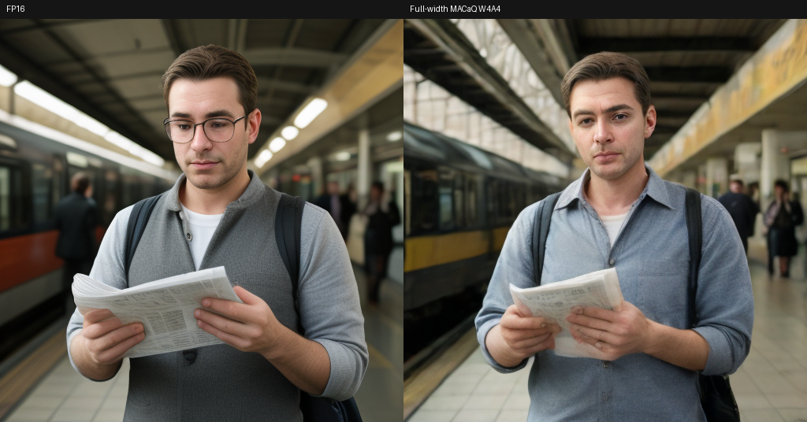
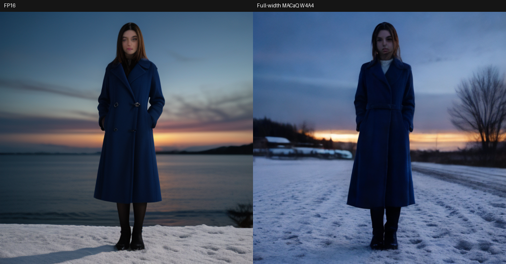
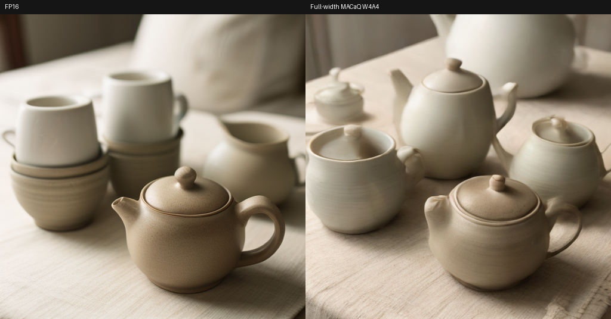
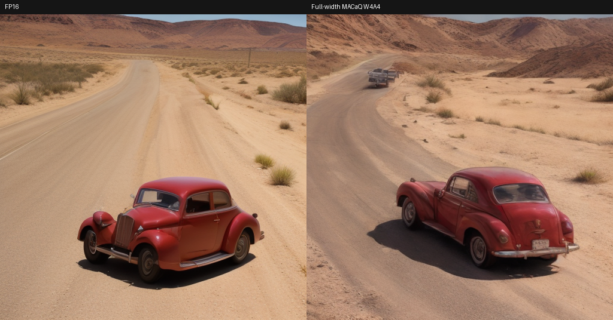
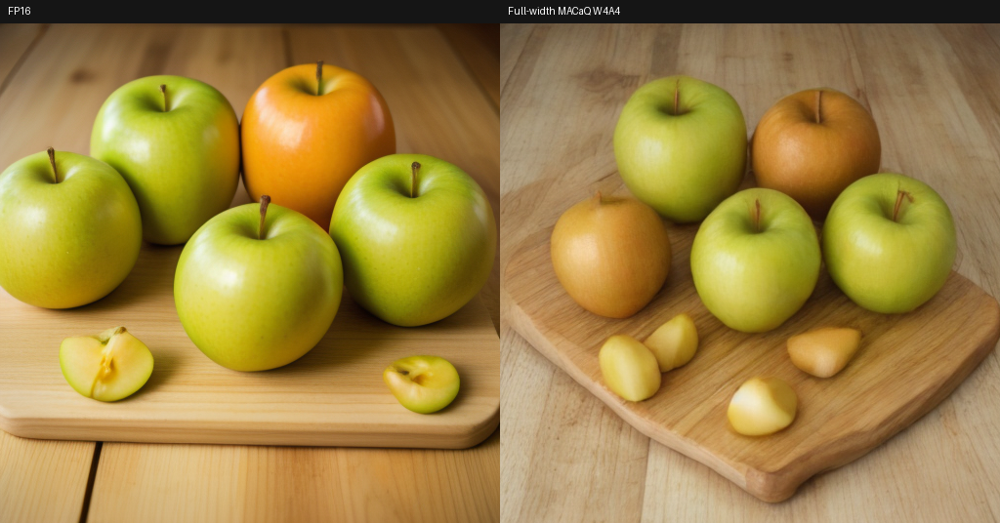

# SD15 MACaQ Pruned Full-Width

[](https://civitai.com/models/166609/realism-by-stable-yogi-pony?modelVersionId=1235013) [](https://huggingface.co/ApacheOne/SD15_MACaQ_pruned_fullwidth) [](https://github.com/Ohio-University-AI-Club/MACaQ_SD15)

[Quick start](#quick-start) · [Inference](#inference) · [License](#license) · [Citations](#citations)

**72.84% smaller U-Net weight payload** · 1,719.04 MB FP16 → **466.96 MB (445.32 MiB)** packed.

This is an MXFP4 W4A4 quantization of Stable Yogi SD 1.5 V9 LCM. It retains the original U-Net layer dimensions. The repository name follows the earlier MACaQ release. The storage savings come from weight quantization, and all U-Net layers remain present.

## Quick start

Clone the repository and open the checkout.

```bash
git clone https://github.com/Ohio-University-AI-Club/MACaQ_SD15.git
cd MACaQ_SD15
```

See [Inference](#inference) for the CUDA dependencies and a generation example that downloads the pinned weights from Hugging Face.

## Weights

Download the three checkpoint files from the [Hugging Face release](https://huggingface.co/ApacheOne/SD15_MACaQ_pruned_fullwidth). The GitHub checkout contains the loader, runtime, configuration, and tokenizer files. The local example below downloads the weights for this exact release revision.

| Component | Precision | Tensor payload |
|---|---|---:|
| U-Net | MXFP4 W4A4 with retained higher-precision tensors | 466.96 MB |
| CLIP text encoder | FP16 | 246.12 MB |
| VAE | FP16 | 167.31 MB |
| **Total weight files including headers** | | **880.62 MB** |

## Full-width calibration

The U-Net was refit from the original FP16 checkpoint. Calibration sampled activations from **32 prompts** with up to **128 rows per forward call**. Each of the **184 linear layers and 98 convolutions** used a Hessian that spans its full input width, including flattened convolution patch channels, with alignment padding to multiples of 32 where needed. The widest layer used **23,040 inputs**. The earlier release used 256-wide convolution Hessian blocks.

The fit balances input channels, applies a blockwise Hadamard rotation, screens block exponents, then refines adjacent FP4 weight codes using the full Hessian at fixed exponents. Each row is refined to a local stopping criterion. Per-layer sample counts, widths, flip counts, and objectives are in the [run report](fullwidth_from_fp16.json).

## FP16 comparisons

Six matched prompt-and-seed pairs were rendered at **512×512** using **LCM, 4 steps, and CFG 1.2**. The left image is FP16 and the right image uses the quantized U-Net. Both use the same CLIP text encoder and VAE. The quantized column used emulated MXFP4 W4A4 on the L4, with FP4 rounding and BF16 matrix multiplication.

The mean LPIPS to FP16 was **0.4292** across these six pairs. Lower values indicate closer image appearance. Some details change, including glasses in the train-station scene and the car's viewing angle. The earlier release's results were reported with SSIM, so this LPIPS result does not rank the two releases.

**Seed 7001** · Candid photo of an adult man holding a newspaper at a train station · LPIPS 0.3830



**Seed 7002** · A full-body photograph of an adult woman in a long blue coat at dusk · LPIPS 0.3491



**Seed 7003** · Close-up of a ceramic teapot, two cups, and a linen napkin on a table · LPIPS 0.3947



**Seed 7004** · A red vintage car parked on a curve in a desert highway, sunny afternoon · LPIPS 0.4756



**Seed 7005** · Portrait of an adult architect wearing black rectangular glasses in a sunlit studio · LPIPS 0.4408


**Seed 7006** · Exactly three green apples beside one yellow pear on a wooden board · LPIPS 0.5322



## U-Net layer inventory

The [JSON inventory](sd15_macaq_unet_layers.json) includes every stored U-Net tensor.

| Layer group | Modules | Storage (MiB) |
|---|---:|---:|
| 3×3 convolutions | 52 | 276.21 |
| Normalization | 109 | 0.38 |
| 1×1 convolutions | 46 | 25.66 |
| Attention projections | 128 | 50.06 |
| MLP projections | 32 | 78.63 |
| Timestep and other linears | 24 | 14.38 |

<details>
<summary>3×3 convolutions · 52 layers</summary>

| Layer | Precision | Original weight shape | Hessian width | Stored bytes | Tensor dtypes and shapes |
|---|---|---|---:|---:|---|
| `conv_in` | MXFP4 W4A4 | 320×4×3×3 | 64 | 46,720 | `B_inv_T` BF16 [32×32], `W_packed` U8 [320×128], `W_scales` U8 [320×8], `bias` BF16 [320], `pre_scale` BF16 [256] |
| `conv_out` | MXFP4 W4A4 | 4×320×3×3 | 2,880 | 14,728 | `B_inv_T` BF16 [32×32], `W_packed` U8 [4×1536], `W_scales` U8 [4×96], `bias` BF16 [4], `pre_scale` BF16 [3072] |
| `down_blocks.0.downsamplers.0.conv` | MXFP4 W4A4 | 320×320×3×3 | 2,880 | 531,072 | `B_inv_T` BF16 [32×32], `W_packed` U8 [320×1536], `W_scales` U8 [320×96], `bias` BF16 [320], `pre_scale` BF16 [3072] |
| `down_blocks.0.resnets.0.conv1` | MXFP4 W4A4 | 320×320×3×3 | 2,880 | 531,072 | `B_inv_T` BF16 [32×32], `W_packed` U8 [320×1536], `W_scales` U8 [320×96], `bias` BF16 [320], `pre_scale` BF16 [3072] |
| `down_blocks.0.resnets.0.conv2` | MXFP4 W4A4 | 320×320×3×3 | 2,880 | 531,072 | `B_inv_T` BF16 [32×32], `W_packed` U8 [320×1536], `W_scales` U8 [320×96], `bias` BF16 [320], `pre_scale` BF16 [3072] |
| `down_blocks.0.resnets.1.conv1` | MXFP4 W4A4 | 320×320×3×3 | 2,880 | 531,072 | `B_inv_T` BF16 [32×32], `W_packed` U8 [320×1536], `W_scales` U8 [320×96], `bias` BF16 [320], `pre_scale` BF16 [3072] |
| `down_blocks.0.resnets.1.conv2` | MXFP4 W4A4 | 320×320×3×3 | 2,880 | 531,072 | `B_inv_T` BF16 [32×32], `W_packed` U8 [320×1536], `W_scales` U8 [320×96], `bias` BF16 [320], `pre_scale` BF16 [3072] |
| `down_blocks.1.downsamplers.0.conv` | MXFP4 W4A4 | 640×640×3×3 | 5,760 | 2,017,024 | `B_inv_T` BF16 [32×32], `W_packed` U8 [640×2944], `W_scales` U8 [640×184], `bias` BF16 [640], `pre_scale` BF16 [5888] |
| `down_blocks.1.resnets.0.conv1` | MXFP4 W4A4 | 640×320×3×3 | 2,880 | 1,053,952 | `B_inv_T` BF16 [32×32], `W_packed` U8 [640×1536], `W_scales` U8 [640×96], `bias` BF16 [640], `pre_scale` BF16 [3072] |
| `down_blocks.1.resnets.0.conv2` | MXFP4 W4A4 | 640×640×3×3 | 5,760 | 2,017,024 | `B_inv_T` BF16 [32×32], `W_packed` U8 [640×2944], `W_scales` U8 [640×184], `bias` BF16 [640], `pre_scale` BF16 [5888] |
| `down_blocks.1.resnets.1.conv1` | MXFP4 W4A4 | 640×640×3×3 | 5,760 | 2,017,024 | `B_inv_T` BF16 [32×32], `W_packed` U8 [640×2944], `W_scales` U8 [640×184], `bias` BF16 [640], `pre_scale` BF16 [5888] |
| `down_blocks.1.resnets.1.conv2` | MXFP4 W4A4 | 640×640×3×3 | 5,760 | 2,017,024 | `B_inv_T` BF16 [32×32], `W_packed` U8 [640×2944], `W_scales` U8 [640×184], `bias` BF16 [640], `pre_scale` BF16 [5888] |
| `down_blocks.2.downsamplers.0.conv` | MXFP4 W4A4 | 1280×1280×3×3 | 11,520 | 7,861,248 | `B_inv_T` BF16 [32×32], `W_packed` U8 [1280×5760], `W_scales` U8 [1280×360], `bias` BF16 [1280], `pre_scale` BF16 [11520] |
| `down_blocks.2.resnets.0.conv1` | MXFP4 W4A4 | 1280×640×3×3 | 5,760 | 4,020,224 | `B_inv_T` BF16 [32×32], `W_packed` U8 [1280×2944], `W_scales` U8 [1280×184], `bias` BF16 [1280], `pre_scale` BF16 [5888] |
| `down_blocks.2.resnets.0.conv2` | MXFP4 W4A4 | 1280×1280×3×3 | 11,520 | 7,861,248 | `B_inv_T` BF16 [32×32], `W_packed` U8 [1280×5760], `W_scales` U8 [1280×360], `bias` BF16 [1280], `pre_scale` BF16 [11520] |
| `down_blocks.2.resnets.1.conv1` | MXFP4 W4A4 | 1280×1280×3×3 | 11,520 | 7,861,248 | `B_inv_T` BF16 [32×32], `W_packed` U8 [1280×5760], `W_scales` U8 [1280×360], `bias` BF16 [1280], `pre_scale` BF16 [11520] |
| `down_blocks.2.resnets.1.conv2` | MXFP4 W4A4 | 1280×1280×3×3 | 11,520 | 7,861,248 | `B_inv_T` BF16 [32×32], `W_packed` U8 [1280×5760], `W_scales` U8 [1280×360], `bias` BF16 [1280], `pre_scale` BF16 [11520] |
| `down_blocks.3.resnets.0.conv1` | MXFP4 W4A4 | 1280×1280×3×3 | 11,520 | 7,861,248 | `B_inv_T` BF16 [32×32], `W_packed` U8 [1280×5760], `W_scales` U8 [1280×360], `bias` BF16 [1280], `pre_scale` BF16 [11520] |
| `down_blocks.3.resnets.0.conv2` | MXFP4 W4A4 | 1280×1280×3×3 | 11,520 | 7,861,248 | `B_inv_T` BF16 [32×32], `W_packed` U8 [1280×5760], `W_scales` U8 [1280×360], `bias` BF16 [1280], `pre_scale` BF16 [11520] |
| `down_blocks.3.resnets.1.conv1` | MXFP4 W4A4 | 1280×1280×3×3 | 11,520 | 7,861,248 | `B_inv_T` BF16 [32×32], `W_packed` U8 [1280×5760], `W_scales` U8 [1280×360], `bias` BF16 [1280], `pre_scale` BF16 [11520] |
| `down_blocks.3.resnets.1.conv2` | MXFP4 W4A4 | 1280×1280×3×3 | 11,520 | 7,861,248 | `B_inv_T` BF16 [32×32], `W_packed` U8 [1280×5760], `W_scales` U8 [1280×360], `bias` BF16 [1280], `pre_scale` BF16 [11520] |
| `mid_block.resnets.0.conv1` | MXFP4 W4A4 | 1280×1280×3×3 | 11,520 | 7,861,248 | `B_inv_T` BF16 [32×32], `W_packed` U8 [1280×5760], `W_scales` U8 [1280×360], `bias` BF16 [1280], `pre_scale` BF16 [11520] |
| `mid_block.resnets.0.conv2` | MXFP4 W4A4 | 1280×1280×3×3 | 11,520 | 7,861,248 | `B_inv_T` BF16 [32×32], `W_packed` U8 [1280×5760], `W_scales` U8 [1280×360], `bias` BF16 [1280], `pre_scale` BF16 [11520] |
| `mid_block.resnets.1.conv1` | MXFP4 W4A4 | 1280×1280×3×3 | 11,520 | 7,861,248 | `B_inv_T` BF16 [32×32], `W_packed` U8 [1280×5760], `W_scales` U8 [1280×360], `bias` BF16 [1280], `pre_scale` BF16 [11520] |
| `mid_block.resnets.1.conv2` | MXFP4 W4A4 | 1280×1280×3×3 | 11,520 | 7,861,248 | `B_inv_T` BF16 [32×32], `W_packed` U8 [1280×5760], `W_scales` U8 [1280×360], `bias` BF16 [1280], `pre_scale` BF16 [11520] |
| `up_blocks.0.resnets.0.conv1` | MXFP4 W4A4 | 1280×2560×3×3 | 23,040 | 15,717,888 | `B_inv_T` BF16 [32×32], `W_packed` U8 [1280×11520], `W_scales` U8 [1280×720], `bias` BF16 [1280], `pre_scale` BF16 [23040] |
| `up_blocks.0.resnets.0.conv2` | MXFP4 W4A4 | 1280×1280×3×3 | 11,520 | 7,861,248 | `B_inv_T` BF16 [32×32], `W_packed` U8 [1280×5760], `W_scales` U8 [1280×360], `bias` BF16 [1280], `pre_scale` BF16 [11520] |
| `up_blocks.0.resnets.1.conv1` | MXFP4 W4A4 | 1280×2560×3×3 | 23,040 | 15,717,888 | `B_inv_T` BF16 [32×32], `W_packed` U8 [1280×11520], `W_scales` U8 [1280×720], `bias` BF16 [1280], `pre_scale` BF16 [23040] |
| `up_blocks.0.resnets.1.conv2` | MXFP4 W4A4 | 1280×1280×3×3 | 11,520 | 7,861,248 | `B_inv_T` BF16 [32×32], `W_packed` U8 [1280×5760], `W_scales` U8 [1280×360], `bias` BF16 [1280], `pre_scale` BF16 [11520] |
| `up_blocks.0.resnets.2.conv1` | MXFP4 W4A4 | 1280×2560×3×3 | 23,040 | 15,717,888 | `B_inv_T` BF16 [32×32], `W_packed` U8 [1280×11520], `W_scales` U8 [1280×720], `bias` BF16 [1280], `pre_scale` BF16 [23040] |
| `up_blocks.0.resnets.2.conv2` | MXFP4 W4A4 | 1280×1280×3×3 | 11,520 | 7,861,248 | `B_inv_T` BF16 [32×32], `W_packed` U8 [1280×5760], `W_scales` U8 [1280×360], `bias` BF16 [1280], `pre_scale` BF16 [11520] |
| `up_blocks.0.upsamplers.0.conv` | MXFP4 W4A4 | 1280×1280×3×3 | 11,520 | 7,861,248 | `B_inv_T` BF16 [32×32], `W_packed` U8 [1280×5760], `W_scales` U8 [1280×360], `bias` BF16 [1280], `pre_scale` BF16 [11520] |
| `up_blocks.1.resnets.0.conv1` | MXFP4 W4A4 | 1280×2560×3×3 | 23,040 | 15,717,888 | `B_inv_T` BF16 [32×32], `W_packed` U8 [1280×11520], `W_scales` U8 [1280×720], `bias` BF16 [1280], `pre_scale` BF16 [23040] |
| `up_blocks.1.resnets.0.conv2` | MXFP4 W4A4 | 1280×1280×3×3 | 11,520 | 7,861,248 | `B_inv_T` BF16 [32×32], `W_packed` U8 [1280×5760], `W_scales` U8 [1280×360], `bias` BF16 [1280], `pre_scale` BF16 [11520] |
| `up_blocks.1.resnets.1.conv1` | MXFP4 W4A4 | 1280×2560×3×3 | 23,040 | 15,717,888 | `B_inv_T` BF16 [32×32], `W_packed` U8 [1280×11520], `W_scales` U8 [1280×720], `bias` BF16 [1280], `pre_scale` BF16 [23040] |
| `up_blocks.1.resnets.1.conv2` | MXFP4 W4A4 | 1280×1280×3×3 | 11,520 | 7,861,248 | `B_inv_T` BF16 [32×32], `W_packed` U8 [1280×5760], `W_scales` U8 [1280×360], `bias` BF16 [1280], `pre_scale` BF16 [11520] |
| `up_blocks.1.resnets.2.conv1` | MXFP4 W4A4 | 1280×1920×3×3 | 17,280 | 11,876,864 | `B_inv_T` BF16 [32×32], `W_packed` U8 [1280×8704], `W_scales` U8 [1280×544], `bias` BF16 [1280], `pre_scale` BF16 [17408] |
| `up_blocks.1.resnets.2.conv2` | MXFP4 W4A4 | 1280×1280×3×3 | 11,520 | 7,861,248 | `B_inv_T` BF16 [32×32], `W_packed` U8 [1280×5760], `W_scales` U8 [1280×360], `bias` BF16 [1280], `pre_scale` BF16 [11520] |
| `up_blocks.1.upsamplers.0.conv` | MXFP4 W4A4 | 1280×1280×3×3 | 11,520 | 7,861,248 | `B_inv_T` BF16 [32×32], `W_packed` U8 [1280×5760], `W_scales` U8 [1280×360], `bias` BF16 [1280], `pre_scale` BF16 [11520] |
| `up_blocks.2.resnets.0.conv1` | MXFP4 W4A4 | 640×1920×3×3 | 17,280 | 5,956,864 | `B_inv_T` BF16 [32×32], `W_packed` U8 [640×8704], `W_scales` U8 [640×544], `bias` BF16 [640], `pre_scale` BF16 [17408] |
| `up_blocks.2.resnets.0.conv2` | MXFP4 W4A4 | 640×640×3×3 | 5,760 | 2,017,024 | `B_inv_T` BF16 [32×32], `W_packed` U8 [640×2944], `W_scales` U8 [640×184], `bias` BF16 [640], `pre_scale` BF16 [5888] |
| `up_blocks.2.resnets.1.conv1` | MXFP4 W4A4 | 640×1280×3×3 | 11,520 | 3,943,168 | `B_inv_T` BF16 [32×32], `W_packed` U8 [640×5760], `W_scales` U8 [640×360], `bias` BF16 [640], `pre_scale` BF16 [11520] |
| `up_blocks.2.resnets.1.conv2` | MXFP4 W4A4 | 640×640×3×3 | 5,760 | 2,017,024 | `B_inv_T` BF16 [32×32], `W_packed` U8 [640×2944], `W_scales` U8 [640×184], `bias` BF16 [640], `pre_scale` BF16 [5888] |
| `up_blocks.2.resnets.2.conv1` | MXFP4 W4A4 | 640×960×3×3 | 8,640 | 2,980,096 | `B_inv_T` BF16 [32×32], `W_packed` U8 [640×4352], `W_scales` U8 [640×272], `bias` BF16 [640], `pre_scale` BF16 [8704] |
| `up_blocks.2.resnets.2.conv2` | MXFP4 W4A4 | 640×640×3×3 | 5,760 | 2,017,024 | `B_inv_T` BF16 [32×32], `W_packed` U8 [640×2944], `W_scales` U8 [640×184], `bias` BF16 [640], `pre_scale` BF16 [5888] |
| `up_blocks.2.upsamplers.0.conv` | MXFP4 W4A4 | 640×640×3×3 | 5,760 | 2,017,024 | `B_inv_T` BF16 [32×32], `W_packed` U8 [640×2944], `W_scales` U8 [640×184], `bias` BF16 [640], `pre_scale` BF16 [5888] |
| `up_blocks.3.resnets.0.conv1` | MXFP4 W4A4 | 320×960×3×3 | 8,640 | 1,499,776 | `B_inv_T` BF16 [32×32], `W_packed` U8 [320×4352], `W_scales` U8 [320×272], `bias` BF16 [320], `pre_scale` BF16 [8704] |
| `up_blocks.3.resnets.0.conv2` | MXFP4 W4A4 | 320×320×3×3 | 2,880 | 531,072 | `B_inv_T` BF16 [32×32], `W_packed` U8 [320×1536], `W_scales` U8 [320×96], `bias` BF16 [320], `pre_scale` BF16 [3072] |
| `up_blocks.3.resnets.1.conv1` | MXFP4 W4A4 | 320×640×3×3 | 5,760 | 1,015,424 | `B_inv_T` BF16 [32×32], `W_packed` U8 [320×2944], `W_scales` U8 [320×184], `bias` BF16 [320], `pre_scale` BF16 [5888] |
| `up_blocks.3.resnets.1.conv2` | MXFP4 W4A4 | 320×320×3×3 | 2,880 | 531,072 | `B_inv_T` BF16 [32×32], `W_packed` U8 [320×1536], `W_scales` U8 [320×96], `bias` BF16 [320], `pre_scale` BF16 [3072] |
| `up_blocks.3.resnets.2.conv1` | MXFP4 W4A4 | 320×640×3×3 | 5,760 | 1,015,424 | `B_inv_T` BF16 [32×32], `W_packed` U8 [320×2944], `W_scales` U8 [320×184], `bias` BF16 [320], `pre_scale` BF16 [5888] |
| `up_blocks.3.resnets.2.conv2` | MXFP4 W4A4 | 320×320×3×3 | 2,880 | 531,072 | `B_inv_T` BF16 [32×32], `W_packed` U8 [320×1536], `W_scales` U8 [320×96], `bias` BF16 [320], `pre_scale` BF16 [3072] |

</details>

<details>
<summary>Normalization · 109 layers</summary>

| Layer | Precision | Original weight shape | Hessian width | Stored bytes | Tensor dtypes and shapes |
|---|---|---|---:|---:|---|
| `conv_norm_out` | F16 | 320 | — | 1,280 | `bias` F16 [320], `weight` F16 [320] |
| `down_blocks.0.attentions.0.norm` | F16 | 320 | — | 1,280 | `bias` F16 [320], `weight` F16 [320] |
| `down_blocks.0.attentions.0.transformer_blocks.0.norm1` | F16 | 320 | — | 1,280 | `bias` F16 [320], `weight` F16 [320] |
| `down_blocks.0.attentions.0.transformer_blocks.0.norm2` | F16 | 320 | — | 1,280 | `bias` F16 [320], `weight` F16 [320] |
| `down_blocks.0.attentions.0.transformer_blocks.0.norm3` | F16 | 320 | — | 1,280 | `bias` F16 [320], `weight` F16 [320] |
| `down_blocks.0.attentions.1.norm` | F16 | 320 | — | 1,280 | `bias` F16 [320], `weight` F16 [320] |
| `down_blocks.0.attentions.1.transformer_blocks.0.norm1` | F16 | 320 | — | 1,280 | `bias` F16 [320], `weight` F16 [320] |
| `down_blocks.0.attentions.1.transformer_blocks.0.norm2` | F16 | 320 | — | 1,280 | `bias` F16 [320], `weight` F16 [320] |
| `down_blocks.0.attentions.1.transformer_blocks.0.norm3` | F16 | 320 | — | 1,280 | `bias` F16 [320], `weight` F16 [320] |
| `down_blocks.0.resnets.0.norm1` | F16 | 320 | — | 1,280 | `bias` F16 [320], `weight` F16 [320] |
| `down_blocks.0.resnets.0.norm2` | F16 | 320 | — | 1,280 | `bias` F16 [320], `weight` F16 [320] |
| `down_blocks.0.resnets.1.norm1` | F16 | 320 | — | 1,280 | `bias` F16 [320], `weight` F16 [320] |
| `down_blocks.0.resnets.1.norm2` | F16 | 320 | — | 1,280 | `bias` F16 [320], `weight` F16 [320] |
| `down_blocks.1.attentions.0.norm` | F16 | 640 | — | 2,560 | `bias` F16 [640], `weight` F16 [640] |
| `down_blocks.1.attentions.0.transformer_blocks.0.norm1` | F16 | 640 | — | 2,560 | `bias` F16 [640], `weight` F16 [640] |
| `down_blocks.1.attentions.0.transformer_blocks.0.norm2` | F16 | 640 | — | 2,560 | `bias` F16 [640], `weight` F16 [640] |
| `down_blocks.1.attentions.0.transformer_blocks.0.norm3` | F16 | 640 | — | 2,560 | `bias` F16 [640], `weight` F16 [640] |
| `down_blocks.1.attentions.1.norm` | F16 | 640 | — | 2,560 | `bias` F16 [640], `weight` F16 [640] |
| `down_blocks.1.attentions.1.transformer_blocks.0.norm1` | F16 | 640 | — | 2,560 | `bias` F16 [640], `weight` F16 [640] |
| `down_blocks.1.attentions.1.transformer_blocks.0.norm2` | F16 | 640 | — | 2,560 | `bias` F16 [640], `weight` F16 [640] |
| `down_blocks.1.attentions.1.transformer_blocks.0.norm3` | F16 | 640 | — | 2,560 | `bias` F16 [640], `weight` F16 [640] |
| `down_blocks.1.resnets.0.norm1` | F16 | 320 | — | 1,280 | `bias` F16 [320], `weight` F16 [320] |
| `down_blocks.1.resnets.0.norm2` | F16 | 640 | — | 2,560 | `bias` F16 [640], `weight` F16 [640] |
| `down_blocks.1.resnets.1.norm1` | F16 | 640 | — | 2,560 | `bias` F16 [640], `weight` F16 [640] |
| `down_blocks.1.resnets.1.norm2` | F16 | 640 | — | 2,560 | `bias` F16 [640], `weight` F16 [640] |
| `down_blocks.2.attentions.0.norm` | F16 | 1280 | — | 5,120 | `bias` F16 [1280], `weight` F16 [1280] |
| `down_blocks.2.attentions.0.transformer_blocks.0.norm1` | F16 | 1280 | — | 5,120 | `bias` F16 [1280], `weight` F16 [1280] |
| `down_blocks.2.attentions.0.transformer_blocks.0.norm2` | F16 | 1280 | — | 5,120 | `bias` F16 [1280], `weight` F16 [1280] |
| `down_blocks.2.attentions.0.transformer_blocks.0.norm3` | F16 | 1280 | — | 5,120 | `bias` F16 [1280], `weight` F16 [1280] |
| `down_blocks.2.attentions.1.norm` | F16 | 1280 | — | 5,120 | `bias` F16 [1280], `weight` F16 [1280] |
| `down_blocks.2.attentions.1.transformer_blocks.0.norm1` | F16 | 1280 | — | 5,120 | `bias` F16 [1280], `weight` F16 [1280] |
| `down_blocks.2.attentions.1.transformer_blocks.0.norm2` | F16 | 1280 | — | 5,120 | `bias` F16 [1280], `weight` F16 [1280] |
| `down_blocks.2.attentions.1.transformer_blocks.0.norm3` | F16 | 1280 | — | 5,120 | `bias` F16 [1280], `weight` F16 [1280] |
| `down_blocks.2.resnets.0.norm1` | F16 | 640 | — | 2,560 | `bias` F16 [640], `weight` F16 [640] |
| `down_blocks.2.resnets.0.norm2` | F16 | 1280 | — | 5,120 | `bias` F16 [1280], `weight` F16 [1280] |
| `down_blocks.2.resnets.1.norm1` | F16 | 1280 | — | 5,120 | `bias` F16 [1280], `weight` F16 [1280] |
| `down_blocks.2.resnets.1.norm2` | F16 | 1280 | — | 5,120 | `bias` F16 [1280], `weight` F16 [1280] |
| `down_blocks.3.resnets.0.norm1` | F16 | 1280 | — | 5,120 | `bias` F16 [1280], `weight` F16 [1280] |
| `down_blocks.3.resnets.0.norm2` | F16 | 1280 | — | 5,120 | `bias` F16 [1280], `weight` F16 [1280] |
| `down_blocks.3.resnets.1.norm1` | F16 | 1280 | — | 5,120 | `bias` F16 [1280], `weight` F16 [1280] |
| `down_blocks.3.resnets.1.norm2` | F16 | 1280 | — | 5,120 | `bias` F16 [1280], `weight` F16 [1280] |
| `mid_block.attentions.0.norm` | F16 | 1280 | — | 5,120 | `bias` F16 [1280], `weight` F16 [1280] |
| `mid_block.attentions.0.transformer_blocks.0.norm1` | F16 | 1280 | — | 5,120 | `bias` F16 [1280], `weight` F16 [1280] |
| `mid_block.attentions.0.transformer_blocks.0.norm2` | F16 | 1280 | — | 5,120 | `bias` F16 [1280], `weight` F16 [1280] |
| `mid_block.attentions.0.transformer_blocks.0.norm3` | F16 | 1280 | — | 5,120 | `bias` F16 [1280], `weight` F16 [1280] |
| `mid_block.resnets.0.norm1` | F16 | 1280 | — | 5,120 | `bias` F16 [1280], `weight` F16 [1280] |
| `mid_block.resnets.0.norm2` | F16 | 1280 | — | 5,120 | `bias` F16 [1280], `weight` F16 [1280] |
| `mid_block.resnets.1.norm1` | F16 | 1280 | — | 5,120 | `bias` F16 [1280], `weight` F16 [1280] |
| `mid_block.resnets.1.norm2` | F16 | 1280 | — | 5,120 | `bias` F16 [1280], `weight` F16 [1280] |
| `up_blocks.0.resnets.0.norm1` | F16 | 2560 | — | 10,240 | `bias` F16 [2560], `weight` F16 [2560] |
| `up_blocks.0.resnets.0.norm2` | F16 | 1280 | — | 5,120 | `bias` F16 [1280], `weight` F16 [1280] |
| `up_blocks.0.resnets.1.norm1` | F16 | 2560 | — | 10,240 | `bias` F16 [2560], `weight` F16 [2560] |
| `up_blocks.0.resnets.1.norm2` | F16 | 1280 | — | 5,120 | `bias` F16 [1280], `weight` F16 [1280] |
| `up_blocks.0.resnets.2.norm1` | F16 | 2560 | — | 10,240 | `bias` F16 [2560], `weight` F16 [2560] |
| `up_blocks.0.resnets.2.norm2` | F16 | 1280 | — | 5,120 | `bias` F16 [1280], `weight` F16 [1280] |
| `up_blocks.1.attentions.0.norm` | F16 | 1280 | — | 5,120 | `bias` F16 [1280], `weight` F16 [1280] |
| `up_blocks.1.attentions.0.transformer_blocks.0.norm1` | F16 | 1280 | — | 5,120 | `bias` F16 [1280], `weight` F16 [1280] |
| `up_blocks.1.attentions.0.transformer_blocks.0.norm2` | F16 | 1280 | — | 5,120 | `bias` F16 [1280], `weight` F16 [1280] |
| `up_blocks.1.attentions.0.transformer_blocks.0.norm3` | F16 | 1280 | — | 5,120 | `bias` F16 [1280], `weight` F16 [1280] |
| `up_blocks.1.attentions.1.norm` | F16 | 1280 | — | 5,120 | `bias` F16 [1280], `weight` F16 [1280] |
| `up_blocks.1.attentions.1.transformer_blocks.0.norm1` | F16 | 1280 | — | 5,120 | `bias` F16 [1280], `weight` F16 [1280] |
| `up_blocks.1.attentions.1.transformer_blocks.0.norm2` | F16 | 1280 | — | 5,120 | `bias` F16 [1280], `weight` F16 [1280] |
| `up_blocks.1.attentions.1.transformer_blocks.0.norm3` | F16 | 1280 | — | 5,120 | `bias` F16 [1280], `weight` F16 [1280] |
| `up_blocks.1.attentions.2.norm` | F16 | 1280 | — | 5,120 | `bias` F16 [1280], `weight` F16 [1280] |
| `up_blocks.1.attentions.2.transformer_blocks.0.norm1` | F16 | 1280 | — | 5,120 | `bias` F16 [1280], `weight` F16 [1280] |
| `up_blocks.1.attentions.2.transformer_blocks.0.norm2` | F16 | 1280 | — | 5,120 | `bias` F16 [1280], `weight` F16 [1280] |
| `up_blocks.1.attentions.2.transformer_blocks.0.norm3` | F16 | 1280 | — | 5,120 | `bias` F16 [1280], `weight` F16 [1280] |
| `up_blocks.1.resnets.0.norm1` | F16 | 2560 | — | 10,240 | `bias` F16 [2560], `weight` F16 [2560] |
| `up_blocks.1.resnets.0.norm2` | F16 | 1280 | — | 5,120 | `bias` F16 [1280], `weight` F16 [1280] |
| `up_blocks.1.resnets.1.norm1` | F16 | 2560 | — | 10,240 | `bias` F16 [2560], `weight` F16 [2560] |
| `up_blocks.1.resnets.1.norm2` | F16 | 1280 | — | 5,120 | `bias` F16 [1280], `weight` F16 [1280] |
| `up_blocks.1.resnets.2.norm1` | F16 | 1920 | — | 7,680 | `bias` F16 [1920], `weight` F16 [1920] |
| `up_blocks.1.resnets.2.norm2` | F16 | 1280 | — | 5,120 | `bias` F16 [1280], `weight` F16 [1280] |
| `up_blocks.2.attentions.0.norm` | F16 | 640 | — | 2,560 | `bias` F16 [640], `weight` F16 [640] |
| `up_blocks.2.attentions.0.transformer_blocks.0.norm1` | F16 | 640 | — | 2,560 | `bias` F16 [640], `weight` F16 [640] |
| `up_blocks.2.attentions.0.transformer_blocks.0.norm2` | F16 | 640 | — | 2,560 | `bias` F16 [640], `weight` F16 [640] |
| `up_blocks.2.attentions.0.transformer_blocks.0.norm3` | F16 | 640 | — | 2,560 | `bias` F16 [640], `weight` F16 [640] |
| `up_blocks.2.attentions.1.norm` | F16 | 640 | — | 2,560 | `bias` F16 [640], `weight` F16 [640] |
| `up_blocks.2.attentions.1.transformer_blocks.0.norm1` | F16 | 640 | — | 2,560 | `bias` F16 [640], `weight` F16 [640] |
| `up_blocks.2.attentions.1.transformer_blocks.0.norm2` | F16 | 640 | — | 2,560 | `bias` F16 [640], `weight` F16 [640] |
| `up_blocks.2.attentions.1.transformer_blocks.0.norm3` | F16 | 640 | — | 2,560 | `bias` F16 [640], `weight` F16 [640] |
| `up_blocks.2.attentions.2.norm` | F16 | 640 | — | 2,560 | `bias` F16 [640], `weight` F16 [640] |
| `up_blocks.2.attentions.2.transformer_blocks.0.norm1` | F16 | 640 | — | 2,560 | `bias` F16 [640], `weight` F16 [640] |
| `up_blocks.2.attentions.2.transformer_blocks.0.norm2` | F16 | 640 | — | 2,560 | `bias` F16 [640], `weight` F16 [640] |
| `up_blocks.2.attentions.2.transformer_blocks.0.norm3` | F16 | 640 | — | 2,560 | `bias` F16 [640], `weight` F16 [640] |
| `up_blocks.2.resnets.0.norm1` | F16 | 1920 | — | 7,680 | `bias` F16 [1920], `weight` F16 [1920] |
| `up_blocks.2.resnets.0.norm2` | F16 | 640 | — | 2,560 | `bias` F16 [640], `weight` F16 [640] |
| `up_blocks.2.resnets.1.norm1` | F16 | 1280 | — | 5,120 | `bias` F16 [1280], `weight` F16 [1280] |
| `up_blocks.2.resnets.1.norm2` | F16 | 640 | — | 2,560 | `bias` F16 [640], `weight` F16 [640] |
| `up_blocks.2.resnets.2.norm1` | F16 | 960 | — | 3,840 | `bias` F16 [960], `weight` F16 [960] |
| `up_blocks.2.resnets.2.norm2` | F16 | 640 | — | 2,560 | `bias` F16 [640], `weight` F16 [640] |
| `up_blocks.3.attentions.0.norm` | F16 | 320 | — | 1,280 | `bias` F16 [320], `weight` F16 [320] |
| `up_blocks.3.attentions.0.transformer_blocks.0.norm1` | F16 | 320 | — | 1,280 | `bias` F16 [320], `weight` F16 [320] |
| `up_blocks.3.attentions.0.transformer_blocks.0.norm2` | F16 | 320 | — | 1,280 | `bias` F16 [320], `weight` F16 [320] |
| `up_blocks.3.attentions.0.transformer_blocks.0.norm3` | F16 | 320 | — | 1,280 | `bias` F16 [320], `weight` F16 [320] |
| `up_blocks.3.attentions.1.norm` | F16 | 320 | — | 1,280 | `bias` F16 [320], `weight` F16 [320] |
| `up_blocks.3.attentions.1.transformer_blocks.0.norm1` | F16 | 320 | — | 1,280 | `bias` F16 [320], `weight` F16 [320] |
| `up_blocks.3.attentions.1.transformer_blocks.0.norm2` | F16 | 320 | — | 1,280 | `bias` F16 [320], `weight` F16 [320] |
| `up_blocks.3.attentions.1.transformer_blocks.0.norm3` | F16 | 320 | — | 1,280 | `bias` F16 [320], `weight` F16 [320] |
| `up_blocks.3.attentions.2.norm` | F16 | 320 | — | 1,280 | `bias` F16 [320], `weight` F16 [320] |
| `up_blocks.3.attentions.2.transformer_blocks.0.norm1` | F16 | 320 | — | 1,280 | `bias` F16 [320], `weight` F16 [320] |
| `up_blocks.3.attentions.2.transformer_blocks.0.norm2` | F16 | 320 | — | 1,280 | `bias` F16 [320], `weight` F16 [320] |
| `up_blocks.3.attentions.2.transformer_blocks.0.norm3` | F16 | 320 | — | 1,280 | `bias` F16 [320], `weight` F16 [320] |
| `up_blocks.3.resnets.0.norm1` | F16 | 960 | — | 3,840 | `bias` F16 [960], `weight` F16 [960] |
| `up_blocks.3.resnets.0.norm2` | F16 | 320 | — | 1,280 | `bias` F16 [320], `weight` F16 [320] |
| `up_blocks.3.resnets.1.norm1` | F16 | 640 | — | 2,560 | `bias` F16 [640], `weight` F16 [640] |
| `up_blocks.3.resnets.1.norm2` | F16 | 320 | — | 1,280 | `bias` F16 [320], `weight` F16 [320] |
| `up_blocks.3.resnets.2.norm1` | F16 | 640 | — | 2,560 | `bias` F16 [640], `weight` F16 [640] |
| `up_blocks.3.resnets.2.norm2` | F16 | 320 | — | 1,280 | `bias` F16 [320], `weight` F16 [320] |

</details>

<details>
<summary>1×1 convolutions · 46 layers</summary>

| Layer | Precision | Original weight shape | Hessian width | Stored bytes | Tensor dtypes and shapes |
|---|---|---|---:|---:|---|
| `down_blocks.0.attentions.0.proj_in` | MXFP4 W4A4 | 320×320×1×1 | 320 | 90,752 | `B_inv_T` BF16 [32×32], `W_packed` U8 [320×256], `W_scales` U8 [320×16], `bias` BF16 [320], `pre_scale` BF16 [512] |
| `down_blocks.0.attentions.0.proj_out` | MXFP4 W4A4 | 320×320×1×1 | 320 | 90,752 | `B_inv_T` BF16 [32×32], `W_packed` U8 [320×256], `W_scales` U8 [320×16], `bias` BF16 [320], `pre_scale` BF16 [512] |
| `down_blocks.0.attentions.1.proj_in` | MXFP4 W4A4 | 320×320×1×1 | 320 | 90,752 | `B_inv_T` BF16 [32×32], `W_packed` U8 [320×256], `W_scales` U8 [320×16], `bias` BF16 [320], `pre_scale` BF16 [512] |
| `down_blocks.0.attentions.1.proj_out` | MXFP4 W4A4 | 320×320×1×1 | 320 | 90,752 | `B_inv_T` BF16 [32×32], `W_packed` U8 [320×256], `W_scales` U8 [320×16], `bias` BF16 [320], `pre_scale` BF16 [512] |
| `down_blocks.1.attentions.0.proj_in` | MXFP4 W4A4 | 640×640×1×1 | 640 | 265,984 | `B_inv_T` BF16 [32×32], `W_packed` U8 [640×384], `W_scales` U8 [640×24], `bias` BF16 [640], `pre_scale` BF16 [768] |
| `down_blocks.1.attentions.0.proj_out` | MXFP4 W4A4 | 640×640×1×1 | 640 | 265,984 | `B_inv_T` BF16 [32×32], `W_packed` U8 [640×384], `W_scales` U8 [640×24], `bias` BF16 [640], `pre_scale` BF16 [768] |
| `down_blocks.1.attentions.1.proj_in` | MXFP4 W4A4 | 640×640×1×1 | 640 | 265,984 | `B_inv_T` BF16 [32×32], `W_packed` U8 [640×384], `W_scales` U8 [640×24], `bias` BF16 [640], `pre_scale` BF16 [768] |
| `down_blocks.1.attentions.1.proj_out` | MXFP4 W4A4 | 640×640×1×1 | 640 | 265,984 | `B_inv_T` BF16 [32×32], `W_packed` U8 [640×384], `W_scales` U8 [640×24], `bias` BF16 [640], `pre_scale` BF16 [768] |
| `down_blocks.1.resnets.0.conv_shortcut` | MXFP4 W4A4 | 640×320×1×1 | 320 | 178,432 | `B_inv_T` BF16 [32×32], `W_packed` U8 [640×256], `W_scales` U8 [640×16], `bias` BF16 [640], `pre_scale` BF16 [512] |
| `down_blocks.2.attentions.0.proj_in` | MXFP4 W4A4 | 1280×1280×1×1 | 1,280 | 877,568 | `B_inv_T` BF16 [32×32], `W_packed` U8 [1280×640], `W_scales` U8 [1280×40], `bias` BF16 [1280], `pre_scale` BF16 [1280] |
| `down_blocks.2.attentions.0.proj_out` | MXFP4 W4A4 | 1280×1280×1×1 | 1,280 | 877,568 | `B_inv_T` BF16 [32×32], `W_packed` U8 [1280×640], `W_scales` U8 [1280×40], `bias` BF16 [1280], `pre_scale` BF16 [1280] |
| `down_blocks.2.attentions.1.proj_in` | MXFP4 W4A4 | 1280×1280×1×1 | 1,280 | 877,568 | `B_inv_T` BF16 [32×32], `W_packed` U8 [1280×640], `W_scales` U8 [1280×40], `bias` BF16 [1280], `pre_scale` BF16 [1280] |
| `down_blocks.2.attentions.1.proj_out` | MXFP4 W4A4 | 1280×1280×1×1 | 1,280 | 877,568 | `B_inv_T` BF16 [32×32], `W_packed` U8 [1280×640], `W_scales` U8 [1280×40], `bias` BF16 [1280], `pre_scale` BF16 [1280] |
| `down_blocks.2.resnets.0.conv_shortcut` | MXFP4 W4A4 | 1280×640×1×1 | 640 | 528,384 | `B_inv_T` BF16 [32×32], `W_packed` U8 [1280×384], `W_scales` U8 [1280×24], `bias` BF16 [1280], `pre_scale` BF16 [768] |
| `mid_block.attentions.0.proj_in` | MXFP4 W4A4 | 1280×1280×1×1 | 1,280 | 877,568 | `B_inv_T` BF16 [32×32], `W_packed` U8 [1280×640], `W_scales` U8 [1280×40], `bias` BF16 [1280], `pre_scale` BF16 [1280] |
| `mid_block.attentions.0.proj_out` | MXFP4 W4A4 | 1280×1280×1×1 | 1,280 | 877,568 | `B_inv_T` BF16 [32×32], `W_packed` U8 [1280×640], `W_scales` U8 [1280×40], `bias` BF16 [1280], `pre_scale` BF16 [1280] |
| `up_blocks.0.resnets.0.conv_shortcut` | MXFP4 W4A4 | 1280×2560×1×1 | 2,560 | 1,750,528 | `B_inv_T` BF16 [32×32], `W_packed` U8 [1280×1280], `W_scales` U8 [1280×80], `bias` BF16 [1280], `pre_scale` BF16 [2560] |
| `up_blocks.0.resnets.1.conv_shortcut` | MXFP4 W4A4 | 1280×2560×1×1 | 2,560 | 1,750,528 | `B_inv_T` BF16 [32×32], `W_packed` U8 [1280×1280], `W_scales` U8 [1280×80], `bias` BF16 [1280], `pre_scale` BF16 [2560] |
| `up_blocks.0.resnets.2.conv_shortcut` | MXFP4 W4A4 | 1280×2560×1×1 | 2,560 | 1,750,528 | `B_inv_T` BF16 [32×32], `W_packed` U8 [1280×1280], `W_scales` U8 [1280×80], `bias` BF16 [1280], `pre_scale` BF16 [2560] |
| `up_blocks.1.attentions.0.proj_in` | MXFP4 W4A4 | 1280×1280×1×1 | 1,280 | 877,568 | `B_inv_T` BF16 [32×32], `W_packed` U8 [1280×640], `W_scales` U8 [1280×40], `bias` BF16 [1280], `pre_scale` BF16 [1280] |
| `up_blocks.1.attentions.0.proj_out` | MXFP4 W4A4 | 1280×1280×1×1 | 1,280 | 877,568 | `B_inv_T` BF16 [32×32], `W_packed` U8 [1280×640], `W_scales` U8 [1280×40], `bias` BF16 [1280], `pre_scale` BF16 [1280] |
| `up_blocks.1.attentions.1.proj_in` | MXFP4 W4A4 | 1280×1280×1×1 | 1,280 | 877,568 | `B_inv_T` BF16 [32×32], `W_packed` U8 [1280×640], `W_scales` U8 [1280×40], `bias` BF16 [1280], `pre_scale` BF16 [1280] |
| `up_blocks.1.attentions.1.proj_out` | MXFP4 W4A4 | 1280×1280×1×1 | 1,280 | 877,568 | `B_inv_T` BF16 [32×32], `W_packed` U8 [1280×640], `W_scales` U8 [1280×40], `bias` BF16 [1280], `pre_scale` BF16 [1280] |
| `up_blocks.1.attentions.2.proj_in` | MXFP4 W4A4 | 1280×1280×1×1 | 1,280 | 877,568 | `B_inv_T` BF16 [32×32], `W_packed` U8 [1280×640], `W_scales` U8 [1280×40], `bias` BF16 [1280], `pre_scale` BF16 [1280] |
| `up_blocks.1.attentions.2.proj_out` | MXFP4 W4A4 | 1280×1280×1×1 | 1,280 | 877,568 | `B_inv_T` BF16 [32×32], `W_packed` U8 [1280×640], `W_scales` U8 [1280×40], `bias` BF16 [1280], `pre_scale` BF16 [1280] |
| `up_blocks.1.resnets.0.conv_shortcut` | MXFP4 W4A4 | 1280×2560×1×1 | 2,560 | 1,750,528 | `B_inv_T` BF16 [32×32], `W_packed` U8 [1280×1280], `W_scales` U8 [1280×80], `bias` BF16 [1280], `pre_scale` BF16 [2560] |
| `up_blocks.1.resnets.1.conv_shortcut` | MXFP4 W4A4 | 1280×2560×1×1 | 2,560 | 1,750,528 | `B_inv_T` BF16 [32×32], `W_packed` U8 [1280×1280], `W_scales` U8 [1280×80], `bias` BF16 [1280], `pre_scale` BF16 [2560] |
| `up_blocks.1.resnets.2.conv_shortcut` | MXFP4 W4A4 | 1280×1920×1×1 | 1,920 | 1,401,344 | `B_inv_T` BF16 [32×32], `W_packed` U8 [1280×1024], `W_scales` U8 [1280×64], `bias` BF16 [1280], `pre_scale` BF16 [2048] |
| `up_blocks.2.attentions.0.proj_in` | MXFP4 W4A4 | 640×640×1×1 | 640 | 265,984 | `B_inv_T` BF16 [32×32], `W_packed` U8 [640×384], `W_scales` U8 [640×24], `bias` BF16 [640], `pre_scale` BF16 [768] |
| `up_blocks.2.attentions.0.proj_out` | MXFP4 W4A4 | 640×640×1×1 | 640 | 265,984 | `B_inv_T` BF16 [32×32], `W_packed` U8 [640×384], `W_scales` U8 [640×24], `bias` BF16 [640], `pre_scale` BF16 [768] |
| `up_blocks.2.attentions.1.proj_in` | MXFP4 W4A4 | 640×640×1×1 | 640 | 265,984 | `B_inv_T` BF16 [32×32], `W_packed` U8 [640×384], `W_scales` U8 [640×24], `bias` BF16 [640], `pre_scale` BF16 [768] |
| `up_blocks.2.attentions.1.proj_out` | MXFP4 W4A4 | 640×640×1×1 | 640 | 265,984 | `B_inv_T` BF16 [32×32], `W_packed` U8 [640×384], `W_scales` U8 [640×24], `bias` BF16 [640], `pre_scale` BF16 [768] |
| `up_blocks.2.attentions.2.proj_in` | MXFP4 W4A4 | 640×640×1×1 | 640 | 265,984 | `B_inv_T` BF16 [32×32], `W_packed` U8 [640×384], `W_scales` U8 [640×24], `bias` BF16 [640], `pre_scale` BF16 [768] |
| `up_blocks.2.attentions.2.proj_out` | MXFP4 W4A4 | 640×640×1×1 | 640 | 265,984 | `B_inv_T` BF16 [32×32], `W_packed` U8 [640×384], `W_scales` U8 [640×24], `bias` BF16 [640], `pre_scale` BF16 [768] |
| `up_blocks.2.resnets.0.conv_shortcut` | MXFP4 W4A4 | 640×1920×1×1 | 1,920 | 703,744 | `B_inv_T` BF16 [32×32], `W_packed` U8 [640×1024], `W_scales` U8 [640×64], `bias` BF16 [640], `pre_scale` BF16 [2048] |
| `up_blocks.2.resnets.1.conv_shortcut` | MXFP4 W4A4 | 640×1280×1×1 | 1,280 | 441,088 | `B_inv_T` BF16 [32×32], `W_packed` U8 [640×640], `W_scales` U8 [640×40], `bias` BF16 [640], `pre_scale` BF16 [1280] |
| `up_blocks.2.resnets.2.conv_shortcut` | MXFP4 W4A4 | 640×960×1×1 | 960 | 353,536 | `B_inv_T` BF16 [32×32], `W_packed` U8 [640×512], `W_scales` U8 [640×32], `bias` BF16 [640], `pre_scale` BF16 [1024] |
| `up_blocks.3.attentions.0.proj_in` | MXFP4 W4A4 | 320×320×1×1 | 320 | 90,752 | `B_inv_T` BF16 [32×32], `W_packed` U8 [320×256], `W_scales` U8 [320×16], `bias` BF16 [320], `pre_scale` BF16 [512] |
| `up_blocks.3.attentions.0.proj_out` | MXFP4 W4A4 | 320×320×1×1 | 320 | 90,752 | `B_inv_T` BF16 [32×32], `W_packed` U8 [320×256], `W_scales` U8 [320×16], `bias` BF16 [320], `pre_scale` BF16 [512] |
| `up_blocks.3.attentions.1.proj_in` | MXFP4 W4A4 | 320×320×1×1 | 320 | 90,752 | `B_inv_T` BF16 [32×32], `W_packed` U8 [320×256], `W_scales` U8 [320×16], `bias` BF16 [320], `pre_scale` BF16 [512] |
| `up_blocks.3.attentions.1.proj_out` | MXFP4 W4A4 | 320×320×1×1 | 320 | 90,752 | `B_inv_T` BF16 [32×32], `W_packed` U8 [320×256], `W_scales` U8 [320×16], `bias` BF16 [320], `pre_scale` BF16 [512] |
| `up_blocks.3.attentions.2.proj_in` | MXFP4 W4A4 | 320×320×1×1 | 320 | 90,752 | `B_inv_T` BF16 [32×32], `W_packed` U8 [320×256], `W_scales` U8 [320×16], `bias` BF16 [320], `pre_scale` BF16 [512] |
| `up_blocks.3.attentions.2.proj_out` | MXFP4 W4A4 | 320×320×1×1 | 320 | 90,752 | `B_inv_T` BF16 [32×32], `W_packed` U8 [320×256], `W_scales` U8 [320×16], `bias` BF16 [320], `pre_scale` BF16 [512] |
| `up_blocks.3.resnets.0.conv_shortcut` | MXFP4 W4A4 | 320×960×1×1 | 960 | 178,816 | `B_inv_T` BF16 [32×32], `W_packed` U8 [320×512], `W_scales` U8 [320×32], `bias` BF16 [320], `pre_scale` BF16 [1024] |
| `up_blocks.3.resnets.1.conv_shortcut` | MXFP4 W4A4 | 320×640×1×1 | 640 | 134,784 | `B_inv_T` BF16 [32×32], `W_packed` U8 [320×384], `W_scales` U8 [320×24], `bias` BF16 [320], `pre_scale` BF16 [768] |
| `up_blocks.3.resnets.2.conv_shortcut` | MXFP4 W4A4 | 320×640×1×1 | 640 | 134,784 | `B_inv_T` BF16 [32×32], `W_packed` U8 [320×384], `W_scales` U8 [320×24], `bias` BF16 [320], `pre_scale` BF16 [768] |

</details>

<details>
<summary>Attention projections · 128 layers</summary>

| Layer | Precision | Original weight shape | Hessian width | Stored bytes | Tensor dtypes and shapes |
|---|---|---|---:|---:|---|
| `down_blocks.0.attentions.0.transformer_blocks.0.attn1.to_k` | MXFP4 W4A4 | 320×320 | 320 | 90,112 | `B_inv_T` BF16 [32×32], `W_packed` U8 [320×256], `W_scales` U8 [320×16], `pre_scale` BF16 [512] |
| `down_blocks.0.attentions.0.transformer_blocks.0.attn1.to_out.0` | MXFP4 W4A4 | 320×320 | 320 | 90,752 | `B_inv_T` BF16 [32×32], `W_packed` U8 [320×256], `W_scales` U8 [320×16], `bias` BF16 [320], `pre_scale` BF16 [512] |
| `down_blocks.0.attentions.0.transformer_blocks.0.attn1.to_q` | MXFP4 W4A4 | 320×320 | 320 | 90,112 | `B_inv_T` BF16 [32×32], `W_packed` U8 [320×256], `W_scales` U8 [320×16], `pre_scale` BF16 [512] |
| `down_blocks.0.attentions.0.transformer_blocks.0.attn1.to_v` | MXFP4 W4A4 | 320×320 | 320 | 90,112 | `B_inv_T` BF16 [32×32], `W_packed` U8 [320×256], `W_scales` U8 [320×16], `pre_scale` BF16 [512] |
| `down_blocks.0.attentions.0.transformer_blocks.0.attn2.to_k` | MXFP4 W4A4 | 320×768 | 768 | 134,144 | `B_inv_T` BF16 [32×32], `W_packed` U8 [320×384], `W_scales` U8 [320×24], `pre_scale` BF16 [768] |
| `down_blocks.0.attentions.0.transformer_blocks.0.attn2.to_out.0` | MXFP4 W4A4 | 320×320 | 320 | 90,752 | `B_inv_T` BF16 [32×32], `W_packed` U8 [320×256], `W_scales` U8 [320×16], `bias` BF16 [320], `pre_scale` BF16 [512] |
| `down_blocks.0.attentions.0.transformer_blocks.0.attn2.to_q` | MXFP4 W4A4 | 320×320 | 320 | 90,112 | `B_inv_T` BF16 [32×32], `W_packed` U8 [320×256], `W_scales` U8 [320×16], `pre_scale` BF16 [512] |
| `down_blocks.0.attentions.0.transformer_blocks.0.attn2.to_v` | MXFP4 W4A4 | 320×768 | 768 | 134,144 | `B_inv_T` BF16 [32×32], `W_packed` U8 [320×384], `W_scales` U8 [320×24], `pre_scale` BF16 [768] |
| `down_blocks.0.attentions.1.transformer_blocks.0.attn1.to_k` | MXFP4 W4A4 | 320×320 | 320 | 90,112 | `B_inv_T` BF16 [32×32], `W_packed` U8 [320×256], `W_scales` U8 [320×16], `pre_scale` BF16 [512] |
| `down_blocks.0.attentions.1.transformer_blocks.0.attn1.to_out.0` | MXFP4 W4A4 | 320×320 | 320 | 90,752 | `B_inv_T` BF16 [32×32], `W_packed` U8 [320×256], `W_scales` U8 [320×16], `bias` BF16 [320], `pre_scale` BF16 [512] |
| `down_blocks.0.attentions.1.transformer_blocks.0.attn1.to_q` | MXFP4 W4A4 | 320×320 | 320 | 90,112 | `B_inv_T` BF16 [32×32], `W_packed` U8 [320×256], `W_scales` U8 [320×16], `pre_scale` BF16 [512] |
| `down_blocks.0.attentions.1.transformer_blocks.0.attn1.to_v` | MXFP4 W4A4 | 320×320 | 320 | 90,112 | `B_inv_T` BF16 [32×32], `W_packed` U8 [320×256], `W_scales` U8 [320×16], `pre_scale` BF16 [512] |
| `down_blocks.0.attentions.1.transformer_blocks.0.attn2.to_k` | MXFP4 W4A4 | 320×768 | 768 | 134,144 | `B_inv_T` BF16 [32×32], `W_packed` U8 [320×384], `W_scales` U8 [320×24], `pre_scale` BF16 [768] |
| `down_blocks.0.attentions.1.transformer_blocks.0.attn2.to_out.0` | MXFP4 W4A4 | 320×320 | 320 | 90,752 | `B_inv_T` BF16 [32×32], `W_packed` U8 [320×256], `W_scales` U8 [320×16], `bias` BF16 [320], `pre_scale` BF16 [512] |
| `down_blocks.0.attentions.1.transformer_blocks.0.attn2.to_q` | MXFP4 W4A4 | 320×320 | 320 | 90,112 | `B_inv_T` BF16 [32×32], `W_packed` U8 [320×256], `W_scales` U8 [320×16], `pre_scale` BF16 [512] |
| `down_blocks.0.attentions.1.transformer_blocks.0.attn2.to_v` | MXFP4 W4A4 | 320×768 | 768 | 134,144 | `B_inv_T` BF16 [32×32], `W_packed` U8 [320×384], `W_scales` U8 [320×24], `pre_scale` BF16 [768] |
| `down_blocks.1.attentions.0.transformer_blocks.0.attn1.to_k` | MXFP4 W4A4 | 640×640 | 640 | 264,704 | `B_inv_T` BF16 [32×32], `W_packed` U8 [640×384], `W_scales` U8 [640×24], `pre_scale` BF16 [768] |
| `down_blocks.1.attentions.0.transformer_blocks.0.attn1.to_out.0` | MXFP4 W4A4 | 640×640 | 640 | 265,984 | `B_inv_T` BF16 [32×32], `W_packed` U8 [640×384], `W_scales` U8 [640×24], `bias` BF16 [640], `pre_scale` BF16 [768] |
| `down_blocks.1.attentions.0.transformer_blocks.0.attn1.to_q` | MXFP4 W4A4 | 640×640 | 640 | 264,704 | `B_inv_T` BF16 [32×32], `W_packed` U8 [640×384], `W_scales` U8 [640×24], `pre_scale` BF16 [768] |
| `down_blocks.1.attentions.0.transformer_blocks.0.attn1.to_v` | MXFP4 W4A4 | 640×640 | 640 | 264,704 | `B_inv_T` BF16 [32×32], `W_packed` U8 [640×384], `W_scales` U8 [640×24], `pre_scale` BF16 [768] |
| `down_blocks.1.attentions.0.transformer_blocks.0.attn2.to_k` | MXFP4 W4A4 | 640×768 | 768 | 264,704 | `B_inv_T` BF16 [32×32], `W_packed` U8 [640×384], `W_scales` U8 [640×24], `pre_scale` BF16 [768] |
| `down_blocks.1.attentions.0.transformer_blocks.0.attn2.to_out.0` | MXFP4 W4A4 | 640×640 | 640 | 265,984 | `B_inv_T` BF16 [32×32], `W_packed` U8 [640×384], `W_scales` U8 [640×24], `bias` BF16 [640], `pre_scale` BF16 [768] |
| `down_blocks.1.attentions.0.transformer_blocks.0.attn2.to_q` | MXFP4 W4A4 | 640×640 | 640 | 264,704 | `B_inv_T` BF16 [32×32], `W_packed` U8 [640×384], `W_scales` U8 [640×24], `pre_scale` BF16 [768] |
| `down_blocks.1.attentions.0.transformer_blocks.0.attn2.to_v` | MXFP4 W4A4 | 640×768 | 768 | 264,704 | `B_inv_T` BF16 [32×32], `W_packed` U8 [640×384], `W_scales` U8 [640×24], `pre_scale` BF16 [768] |
| `down_blocks.1.attentions.1.transformer_blocks.0.attn1.to_k` | MXFP4 W4A4 | 640×640 | 640 | 264,704 | `B_inv_T` BF16 [32×32], `W_packed` U8 [640×384], `W_scales` U8 [640×24], `pre_scale` BF16 [768] |
| `down_blocks.1.attentions.1.transformer_blocks.0.attn1.to_out.0` | MXFP4 W4A4 | 640×640 | 640 | 265,984 | `B_inv_T` BF16 [32×32], `W_packed` U8 [640×384], `W_scales` U8 [640×24], `bias` BF16 [640], `pre_scale` BF16 [768] |
| `down_blocks.1.attentions.1.transformer_blocks.0.attn1.to_q` | MXFP4 W4A4 | 640×640 | 640 | 264,704 | `B_inv_T` BF16 [32×32], `W_packed` U8 [640×384], `W_scales` U8 [640×24], `pre_scale` BF16 [768] |
| `down_blocks.1.attentions.1.transformer_blocks.0.attn1.to_v` | MXFP4 W4A4 | 640×640 | 640 | 264,704 | `B_inv_T` BF16 [32×32], `W_packed` U8 [640×384], `W_scales` U8 [640×24], `pre_scale` BF16 [768] |
| `down_blocks.1.attentions.1.transformer_blocks.0.attn2.to_k` | MXFP4 W4A4 | 640×768 | 768 | 264,704 | `B_inv_T` BF16 [32×32], `W_packed` U8 [640×384], `W_scales` U8 [640×24], `pre_scale` BF16 [768] |
| `down_blocks.1.attentions.1.transformer_blocks.0.attn2.to_out.0` | MXFP4 W4A4 | 640×640 | 640 | 265,984 | `B_inv_T` BF16 [32×32], `W_packed` U8 [640×384], `W_scales` U8 [640×24], `bias` BF16 [640], `pre_scale` BF16 [768] |
| `down_blocks.1.attentions.1.transformer_blocks.0.attn2.to_q` | MXFP4 W4A4 | 640×640 | 640 | 264,704 | `B_inv_T` BF16 [32×32], `W_packed` U8 [640×384], `W_scales` U8 [640×24], `pre_scale` BF16 [768] |
| `down_blocks.1.attentions.1.transformer_blocks.0.attn2.to_v` | MXFP4 W4A4 | 640×768 | 768 | 264,704 | `B_inv_T` BF16 [32×32], `W_packed` U8 [640×384], `W_scales` U8 [640×24], `pre_scale` BF16 [768] |
| `down_blocks.2.attentions.0.transformer_blocks.0.attn1.to_k` | MXFP4 W4A4 | 1280×1280 | 1,280 | 875,008 | `B_inv_T` BF16 [32×32], `W_packed` U8 [1280×640], `W_scales` U8 [1280×40], `pre_scale` BF16 [1280] |
| `down_blocks.2.attentions.0.transformer_blocks.0.attn1.to_out.0` | MXFP4 W4A4 | 1280×1280 | 1,280 | 877,568 | `B_inv_T` BF16 [32×32], `W_packed` U8 [1280×640], `W_scales` U8 [1280×40], `bias` BF16 [1280], `pre_scale` BF16 [1280] |
| `down_blocks.2.attentions.0.transformer_blocks.0.attn1.to_q` | MXFP4 W4A4 | 1280×1280 | 1,280 | 875,008 | `B_inv_T` BF16 [32×32], `W_packed` U8 [1280×640], `W_scales` U8 [1280×40], `pre_scale` BF16 [1280] |
| `down_blocks.2.attentions.0.transformer_blocks.0.attn1.to_v` | MXFP4 W4A4 | 1280×1280 | 1,280 | 875,008 | `B_inv_T` BF16 [32×32], `W_packed` U8 [1280×640], `W_scales` U8 [1280×40], `pre_scale` BF16 [1280] |
| `down_blocks.2.attentions.0.transformer_blocks.0.attn2.to_k` | MXFP4 W4A4 | 1280×768 | 768 | 525,824 | `B_inv_T` BF16 [32×32], `W_packed` U8 [1280×384], `W_scales` U8 [1280×24], `pre_scale` BF16 [768] |
| `down_blocks.2.attentions.0.transformer_blocks.0.attn2.to_out.0` | MXFP4 W4A4 | 1280×1280 | 1,280 | 877,568 | `B_inv_T` BF16 [32×32], `W_packed` U8 [1280×640], `W_scales` U8 [1280×40], `bias` BF16 [1280], `pre_scale` BF16 [1280] |
| `down_blocks.2.attentions.0.transformer_blocks.0.attn2.to_q` | MXFP4 W4A4 | 1280×1280 | 1,280 | 875,008 | `B_inv_T` BF16 [32×32], `W_packed` U8 [1280×640], `W_scales` U8 [1280×40], `pre_scale` BF16 [1280] |
| `down_blocks.2.attentions.0.transformer_blocks.0.attn2.to_v` | MXFP4 W4A4 | 1280×768 | 768 | 525,824 | `B_inv_T` BF16 [32×32], `W_packed` U8 [1280×384], `W_scales` U8 [1280×24], `pre_scale` BF16 [768] |
| `down_blocks.2.attentions.1.transformer_blocks.0.attn1.to_k` | MXFP4 W4A4 | 1280×1280 | 1,280 | 875,008 | `B_inv_T` BF16 [32×32], `W_packed` U8 [1280×640], `W_scales` U8 [1280×40], `pre_scale` BF16 [1280] |
| `down_blocks.2.attentions.1.transformer_blocks.0.attn1.to_out.0` | MXFP4 W4A4 | 1280×1280 | 1,280 | 877,568 | `B_inv_T` BF16 [32×32], `W_packed` U8 [1280×640], `W_scales` U8 [1280×40], `bias` BF16 [1280], `pre_scale` BF16 [1280] |
| `down_blocks.2.attentions.1.transformer_blocks.0.attn1.to_q` | MXFP4 W4A4 | 1280×1280 | 1,280 | 875,008 | `B_inv_T` BF16 [32×32], `W_packed` U8 [1280×640], `W_scales` U8 [1280×40], `pre_scale` BF16 [1280] |
| `down_blocks.2.attentions.1.transformer_blocks.0.attn1.to_v` | MXFP4 W4A4 | 1280×1280 | 1,280 | 875,008 | `B_inv_T` BF16 [32×32], `W_packed` U8 [1280×640], `W_scales` U8 [1280×40], `pre_scale` BF16 [1280] |
| `down_blocks.2.attentions.1.transformer_blocks.0.attn2.to_k` | MXFP4 W4A4 | 1280×768 | 768 | 525,824 | `B_inv_T` BF16 [32×32], `W_packed` U8 [1280×384], `W_scales` U8 [1280×24], `pre_scale` BF16 [768] |
| `down_blocks.2.attentions.1.transformer_blocks.0.attn2.to_out.0` | MXFP4 W4A4 | 1280×1280 | 1,280 | 877,568 | `B_inv_T` BF16 [32×32], `W_packed` U8 [1280×640], `W_scales` U8 [1280×40], `bias` BF16 [1280], `pre_scale` BF16 [1280] |
| `down_blocks.2.attentions.1.transformer_blocks.0.attn2.to_q` | MXFP4 W4A4 | 1280×1280 | 1,280 | 875,008 | `B_inv_T` BF16 [32×32], `W_packed` U8 [1280×640], `W_scales` U8 [1280×40], `pre_scale` BF16 [1280] |
| `down_blocks.2.attentions.1.transformer_blocks.0.attn2.to_v` | MXFP4 W4A4 | 1280×768 | 768 | 525,824 | `B_inv_T` BF16 [32×32], `W_packed` U8 [1280×384], `W_scales` U8 [1280×24], `pre_scale` BF16 [768] |
| `mid_block.attentions.0.transformer_blocks.0.attn1.to_k` | MXFP4 W4A4 | 1280×1280 | 1,280 | 875,008 | `B_inv_T` BF16 [32×32], `W_packed` U8 [1280×640], `W_scales` U8 [1280×40], `pre_scale` BF16 [1280] |
| `mid_block.attentions.0.transformer_blocks.0.attn1.to_out.0` | MXFP4 W4A4 | 1280×1280 | 1,280 | 877,568 | `B_inv_T` BF16 [32×32], `W_packed` U8 [1280×640], `W_scales` U8 [1280×40], `bias` BF16 [1280], `pre_scale` BF16 [1280] |
| `mid_block.attentions.0.transformer_blocks.0.attn1.to_q` | MXFP4 W4A4 | 1280×1280 | 1,280 | 875,008 | `B_inv_T` BF16 [32×32], `W_packed` U8 [1280×640], `W_scales` U8 [1280×40], `pre_scale` BF16 [1280] |
| `mid_block.attentions.0.transformer_blocks.0.attn1.to_v` | MXFP4 W4A4 | 1280×1280 | 1,280 | 875,008 | `B_inv_T` BF16 [32×32], `W_packed` U8 [1280×640], `W_scales` U8 [1280×40], `pre_scale` BF16 [1280] |
| `mid_block.attentions.0.transformer_blocks.0.attn2.to_k` | MXFP4 W4A4 | 1280×768 | 768 | 525,824 | `B_inv_T` BF16 [32×32], `W_packed` U8 [1280×384], `W_scales` U8 [1280×24], `pre_scale` BF16 [768] |
| `mid_block.attentions.0.transformer_blocks.0.attn2.to_out.0` | MXFP4 W4A4 | 1280×1280 | 1,280 | 877,568 | `B_inv_T` BF16 [32×32], `W_packed` U8 [1280×640], `W_scales` U8 [1280×40], `bias` BF16 [1280], `pre_scale` BF16 [1280] |
| `mid_block.attentions.0.transformer_blocks.0.attn2.to_q` | MXFP4 W4A4 | 1280×1280 | 1,280 | 875,008 | `B_inv_T` BF16 [32×32], `W_packed` U8 [1280×640], `W_scales` U8 [1280×40], `pre_scale` BF16 [1280] |
| `mid_block.attentions.0.transformer_blocks.0.attn2.to_v` | MXFP4 W4A4 | 1280×768 | 768 | 525,824 | `B_inv_T` BF16 [32×32], `W_packed` U8 [1280×384], `W_scales` U8 [1280×24], `pre_scale` BF16 [768] |
| `up_blocks.1.attentions.0.transformer_blocks.0.attn1.to_k` | MXFP4 W4A4 | 1280×1280 | 1,280 | 875,008 | `B_inv_T` BF16 [32×32], `W_packed` U8 [1280×640], `W_scales` U8 [1280×40], `pre_scale` BF16 [1280] |
| `up_blocks.1.attentions.0.transformer_blocks.0.attn1.to_out.0` | MXFP4 W4A4 | 1280×1280 | 1,280 | 877,568 | `B_inv_T` BF16 [32×32], `W_packed` U8 [1280×640], `W_scales` U8 [1280×40], `bias` BF16 [1280], `pre_scale` BF16 [1280] |
| `up_blocks.1.attentions.0.transformer_blocks.0.attn1.to_q` | MXFP4 W4A4 | 1280×1280 | 1,280 | 875,008 | `B_inv_T` BF16 [32×32], `W_packed` U8 [1280×640], `W_scales` U8 [1280×40], `pre_scale` BF16 [1280] |
| `up_blocks.1.attentions.0.transformer_blocks.0.attn1.to_v` | MXFP4 W4A4 | 1280×1280 | 1,280 | 875,008 | `B_inv_T` BF16 [32×32], `W_packed` U8 [1280×640], `W_scales` U8 [1280×40], `pre_scale` BF16 [1280] |
| `up_blocks.1.attentions.0.transformer_blocks.0.attn2.to_k` | MXFP4 W4A4 | 1280×768 | 768 | 525,824 | `B_inv_T` BF16 [32×32], `W_packed` U8 [1280×384], `W_scales` U8 [1280×24], `pre_scale` BF16 [768] |
| `up_blocks.1.attentions.0.transformer_blocks.0.attn2.to_out.0` | MXFP4 W4A4 | 1280×1280 | 1,280 | 877,568 | `B_inv_T` BF16 [32×32], `W_packed` U8 [1280×640], `W_scales` U8 [1280×40], `bias` BF16 [1280], `pre_scale` BF16 [1280] |
| `up_blocks.1.attentions.0.transformer_blocks.0.attn2.to_q` | MXFP4 W4A4 | 1280×1280 | 1,280 | 875,008 | `B_inv_T` BF16 [32×32], `W_packed` U8 [1280×640], `W_scales` U8 [1280×40], `pre_scale` BF16 [1280] |
| `up_blocks.1.attentions.0.transformer_blocks.0.attn2.to_v` | MXFP4 W4A4 | 1280×768 | 768 | 525,824 | `B_inv_T` BF16 [32×32], `W_packed` U8 [1280×384], `W_scales` U8 [1280×24], `pre_scale` BF16 [768] |
| `up_blocks.1.attentions.1.transformer_blocks.0.attn1.to_k` | MXFP4 W4A4 | 1280×1280 | 1,280 | 875,008 | `B_inv_T` BF16 [32×32], `W_packed` U8 [1280×640], `W_scales` U8 [1280×40], `pre_scale` BF16 [1280] |
| `up_blocks.1.attentions.1.transformer_blocks.0.attn1.to_out.0` | MXFP4 W4A4 | 1280×1280 | 1,280 | 877,568 | `B_inv_T` BF16 [32×32], `W_packed` U8 [1280×640], `W_scales` U8 [1280×40], `bias` BF16 [1280], `pre_scale` BF16 [1280] |
| `up_blocks.1.attentions.1.transformer_blocks.0.attn1.to_q` | MXFP4 W4A4 | 1280×1280 | 1,280 | 875,008 | `B_inv_T` BF16 [32×32], `W_packed` U8 [1280×640], `W_scales` U8 [1280×40], `pre_scale` BF16 [1280] |
| `up_blocks.1.attentions.1.transformer_blocks.0.attn1.to_v` | MXFP4 W4A4 | 1280×1280 | 1,280 | 875,008 | `B_inv_T` BF16 [32×32], `W_packed` U8 [1280×640], `W_scales` U8 [1280×40], `pre_scale` BF16 [1280] |
| `up_blocks.1.attentions.1.transformer_blocks.0.attn2.to_k` | MXFP4 W4A4 | 1280×768 | 768 | 525,824 | `B_inv_T` BF16 [32×32], `W_packed` U8 [1280×384], `W_scales` U8 [1280×24], `pre_scale` BF16 [768] |
| `up_blocks.1.attentions.1.transformer_blocks.0.attn2.to_out.0` | MXFP4 W4A4 | 1280×1280 | 1,280 | 877,568 | `B_inv_T` BF16 [32×32], `W_packed` U8 [1280×640], `W_scales` U8 [1280×40], `bias` BF16 [1280], `pre_scale` BF16 [1280] |
| `up_blocks.1.attentions.1.transformer_blocks.0.attn2.to_q` | MXFP4 W4A4 | 1280×1280 | 1,280 | 875,008 | `B_inv_T` BF16 [32×32], `W_packed` U8 [1280×640], `W_scales` U8 [1280×40], `pre_scale` BF16 [1280] |
| `up_blocks.1.attentions.1.transformer_blocks.0.attn2.to_v` | MXFP4 W4A4 | 1280×768 | 768 | 525,824 | `B_inv_T` BF16 [32×32], `W_packed` U8 [1280×384], `W_scales` U8 [1280×24], `pre_scale` BF16 [768] |
| `up_blocks.1.attentions.2.transformer_blocks.0.attn1.to_k` | MXFP4 W4A4 | 1280×1280 | 1,280 | 875,008 | `B_inv_T` BF16 [32×32], `W_packed` U8 [1280×640], `W_scales` U8 [1280×40], `pre_scale` BF16 [1280] |
| `up_blocks.1.attentions.2.transformer_blocks.0.attn1.to_out.0` | MXFP4 W4A4 | 1280×1280 | 1,280 | 877,568 | `B_inv_T` BF16 [32×32], `W_packed` U8 [1280×640], `W_scales` U8 [1280×40], `bias` BF16 [1280], `pre_scale` BF16 [1280] |
| `up_blocks.1.attentions.2.transformer_blocks.0.attn1.to_q` | MXFP4 W4A4 | 1280×1280 | 1,280 | 875,008 | `B_inv_T` BF16 [32×32], `W_packed` U8 [1280×640], `W_scales` U8 [1280×40], `pre_scale` BF16 [1280] |
| `up_blocks.1.attentions.2.transformer_blocks.0.attn1.to_v` | MXFP4 W4A4 | 1280×1280 | 1,280 | 875,008 | `B_inv_T` BF16 [32×32], `W_packed` U8 [1280×640], `W_scales` U8 [1280×40], `pre_scale` BF16 [1280] |
| `up_blocks.1.attentions.2.transformer_blocks.0.attn2.to_k` | MXFP4 W4A4 | 1280×768 | 768 | 525,824 | `B_inv_T` BF16 [32×32], `W_packed` U8 [1280×384], `W_scales` U8 [1280×24], `pre_scale` BF16 [768] |
| `up_blocks.1.attentions.2.transformer_blocks.0.attn2.to_out.0` | MXFP4 W4A4 | 1280×1280 | 1,280 | 877,568 | `B_inv_T` BF16 [32×32], `W_packed` U8 [1280×640], `W_scales` U8 [1280×40], `bias` BF16 [1280], `pre_scale` BF16 [1280] |
| `up_blocks.1.attentions.2.transformer_blocks.0.attn2.to_q` | MXFP4 W4A4 | 1280×1280 | 1,280 | 875,008 | `B_inv_T` BF16 [32×32], `W_packed` U8 [1280×640], `W_scales` U8 [1280×40], `pre_scale` BF16 [1280] |
| `up_blocks.1.attentions.2.transformer_blocks.0.attn2.to_v` | MXFP4 W4A4 | 1280×768 | 768 | 525,824 | `B_inv_T` BF16 [32×32], `W_packed` U8 [1280×384], `W_scales` U8 [1280×24], `pre_scale` BF16 [768] |
| `up_blocks.2.attentions.0.transformer_blocks.0.attn1.to_k` | MXFP4 W4A4 | 640×640 | 640 | 264,704 | `B_inv_T` BF16 [32×32], `W_packed` U8 [640×384], `W_scales` U8 [640×24], `pre_scale` BF16 [768] |
| `up_blocks.2.attentions.0.transformer_blocks.0.attn1.to_out.0` | MXFP4 W4A4 | 640×640 | 640 | 265,984 | `B_inv_T` BF16 [32×32], `W_packed` U8 [640×384], `W_scales` U8 [640×24], `bias` BF16 [640], `pre_scale` BF16 [768] |
| `up_blocks.2.attentions.0.transformer_blocks.0.attn1.to_q` | MXFP4 W4A4 | 640×640 | 640 | 264,704 | `B_inv_T` BF16 [32×32], `W_packed` U8 [640×384], `W_scales` U8 [640×24], `pre_scale` BF16 [768] |
| `up_blocks.2.attentions.0.transformer_blocks.0.attn1.to_v` | MXFP4 W4A4 | 640×640 | 640 | 264,704 | `B_inv_T` BF16 [32×32], `W_packed` U8 [640×384], `W_scales` U8 [640×24], `pre_scale` BF16 [768] |
| `up_blocks.2.attentions.0.transformer_blocks.0.attn2.to_k` | MXFP4 W4A4 | 640×768 | 768 | 264,704 | `B_inv_T` BF16 [32×32], `W_packed` U8 [640×384], `W_scales` U8 [640×24], `pre_scale` BF16 [768] |
| `up_blocks.2.attentions.0.transformer_blocks.0.attn2.to_out.0` | MXFP4 W4A4 | 640×640 | 640 | 265,984 | `B_inv_T` BF16 [32×32], `W_packed` U8 [640×384], `W_scales` U8 [640×24], `bias` BF16 [640], `pre_scale` BF16 [768] |
| `up_blocks.2.attentions.0.transformer_blocks.0.attn2.to_q` | MXFP4 W4A4 | 640×640 | 640 | 264,704 | `B_inv_T` BF16 [32×32], `W_packed` U8 [640×384], `W_scales` U8 [640×24], `pre_scale` BF16 [768] |
| `up_blocks.2.attentions.0.transformer_blocks.0.attn2.to_v` | MXFP4 W4A4 | 640×768 | 768 | 264,704 | `B_inv_T` BF16 [32×32], `W_packed` U8 [640×384], `W_scales` U8 [640×24], `pre_scale` BF16 [768] |
| `up_blocks.2.attentions.1.transformer_blocks.0.attn1.to_k` | MXFP4 W4A4 | 640×640 | 640 | 264,704 | `B_inv_T` BF16 [32×32], `W_packed` U8 [640×384], `W_scales` U8 [640×24], `pre_scale` BF16 [768] |
| `up_blocks.2.attentions.1.transformer_blocks.0.attn1.to_out.0` | MXFP4 W4A4 | 640×640 | 640 | 265,984 | `B_inv_T` BF16 [32×32], `W_packed` U8 [640×384], `W_scales` U8 [640×24], `bias` BF16 [640], `pre_scale` BF16 [768] |
| `up_blocks.2.attentions.1.transformer_blocks.0.attn1.to_q` | MXFP4 W4A4 | 640×640 | 640 | 264,704 | `B_inv_T` BF16 [32×32], `W_packed` U8 [640×384], `W_scales` U8 [640×24], `pre_scale` BF16 [768] |
| `up_blocks.2.attentions.1.transformer_blocks.0.attn1.to_v` | MXFP4 W4A4 | 640×640 | 640 | 264,704 | `B_inv_T` BF16 [32×32], `W_packed` U8 [640×384], `W_scales` U8 [640×24], `pre_scale` BF16 [768] |
| `up_blocks.2.attentions.1.transformer_blocks.0.attn2.to_k` | MXFP4 W4A4 | 640×768 | 768 | 264,704 | `B_inv_T` BF16 [32×32], `W_packed` U8 [640×384], `W_scales` U8 [640×24], `pre_scale` BF16 [768] |
| `up_blocks.2.attentions.1.transformer_blocks.0.attn2.to_out.0` | MXFP4 W4A4 | 640×640 | 640 | 265,984 | `B_inv_T` BF16 [32×32], `W_packed` U8 [640×384], `W_scales` U8 [640×24], `bias` BF16 [640], `pre_scale` BF16 [768] |
| `up_blocks.2.attentions.1.transformer_blocks.0.attn2.to_q` | MXFP4 W4A4 | 640×640 | 640 | 264,704 | `B_inv_T` BF16 [32×32], `W_packed` U8 [640×384], `W_scales` U8 [640×24], `pre_scale` BF16 [768] |
| `up_blocks.2.attentions.1.transformer_blocks.0.attn2.to_v` | MXFP4 W4A4 | 640×768 | 768 | 264,704 | `B_inv_T` BF16 [32×32], `W_packed` U8 [640×384], `W_scales` U8 [640×24], `pre_scale` BF16 [768] |
| `up_blocks.2.attentions.2.transformer_blocks.0.attn1.to_k` | MXFP4 W4A4 | 640×640 | 640 | 264,704 | `B_inv_T` BF16 [32×32], `W_packed` U8 [640×384], `W_scales` U8 [640×24], `pre_scale` BF16 [768] |
| `up_blocks.2.attentions.2.transformer_blocks.0.attn1.to_out.0` | MXFP4 W4A4 | 640×640 | 640 | 265,984 | `B_inv_T` BF16 [32×32], `W_packed` U8 [640×384], `W_scales` U8 [640×24], `bias` BF16 [640], `pre_scale` BF16 [768] |
| `up_blocks.2.attentions.2.transformer_blocks.0.attn1.to_q` | MXFP4 W4A4 | 640×640 | 640 | 264,704 | `B_inv_T` BF16 [32×32], `W_packed` U8 [640×384], `W_scales` U8 [640×24], `pre_scale` BF16 [768] |
| `up_blocks.2.attentions.2.transformer_blocks.0.attn1.to_v` | MXFP4 W4A4 | 640×640 | 640 | 264,704 | `B_inv_T` BF16 [32×32], `W_packed` U8 [640×384], `W_scales` U8 [640×24], `pre_scale` BF16 [768] |
| `up_blocks.2.attentions.2.transformer_blocks.0.attn2.to_k` | MXFP4 W4A4 | 640×768 | 768 | 264,704 | `B_inv_T` BF16 [32×32], `W_packed` U8 [640×384], `W_scales` U8 [640×24], `pre_scale` BF16 [768] |
| `up_blocks.2.attentions.2.transformer_blocks.0.attn2.to_out.0` | MXFP4 W4A4 | 640×640 | 640 | 265,984 | `B_inv_T` BF16 [32×32], `W_packed` U8 [640×384], `W_scales` U8 [640×24], `bias` BF16 [640], `pre_scale` BF16 [768] |
| `up_blocks.2.attentions.2.transformer_blocks.0.attn2.to_q` | MXFP4 W4A4 | 640×640 | 640 | 264,704 | `B_inv_T` BF16 [32×32], `W_packed` U8 [640×384], `W_scales` U8 [640×24], `pre_scale` BF16 [768] |
| `up_blocks.2.attentions.2.transformer_blocks.0.attn2.to_v` | MXFP4 W4A4 | 640×768 | 768 | 264,704 | `B_inv_T` BF16 [32×32], `W_packed` U8 [640×384], `W_scales` U8 [640×24], `pre_scale` BF16 [768] |
| `up_blocks.3.attentions.0.transformer_blocks.0.attn1.to_k` | MXFP4 W4A4 | 320×320 | 320 | 90,112 | `B_inv_T` BF16 [32×32], `W_packed` U8 [320×256], `W_scales` U8 [320×16], `pre_scale` BF16 [512] |
| `up_blocks.3.attentions.0.transformer_blocks.0.attn1.to_out.0` | MXFP4 W4A4 | 320×320 | 320 | 90,752 | `B_inv_T` BF16 [32×32], `W_packed` U8 [320×256], `W_scales` U8 [320×16], `bias` BF16 [320], `pre_scale` BF16 [512] |
| `up_blocks.3.attentions.0.transformer_blocks.0.attn1.to_q` | MXFP4 W4A4 | 320×320 | 320 | 90,112 | `B_inv_T` BF16 [32×32], `W_packed` U8 [320×256], `W_scales` U8 [320×16], `pre_scale` BF16 [512] |
| `up_blocks.3.attentions.0.transformer_blocks.0.attn1.to_v` | MXFP4 W4A4 | 320×320 | 320 | 90,112 | `B_inv_T` BF16 [32×32], `W_packed` U8 [320×256], `W_scales` U8 [320×16], `pre_scale` BF16 [512] |
| `up_blocks.3.attentions.0.transformer_blocks.0.attn2.to_k` | MXFP4 W4A4 | 320×768 | 768 | 134,144 | `B_inv_T` BF16 [32×32], `W_packed` U8 [320×384], `W_scales` U8 [320×24], `pre_scale` BF16 [768] |
| `up_blocks.3.attentions.0.transformer_blocks.0.attn2.to_out.0` | MXFP4 W4A4 | 320×320 | 320 | 90,752 | `B_inv_T` BF16 [32×32], `W_packed` U8 [320×256], `W_scales` U8 [320×16], `bias` BF16 [320], `pre_scale` BF16 [512] |
| `up_blocks.3.attentions.0.transformer_blocks.0.attn2.to_q` | MXFP4 W4A4 | 320×320 | 320 | 90,112 | `B_inv_T` BF16 [32×32], `W_packed` U8 [320×256], `W_scales` U8 [320×16], `pre_scale` BF16 [512] |
| `up_blocks.3.attentions.0.transformer_blocks.0.attn2.to_v` | MXFP4 W4A4 | 320×768 | 768 | 134,144 | `B_inv_T` BF16 [32×32], `W_packed` U8 [320×384], `W_scales` U8 [320×24], `pre_scale` BF16 [768] |
| `up_blocks.3.attentions.1.transformer_blocks.0.attn1.to_k` | MXFP4 W4A4 | 320×320 | 320 | 90,112 | `B_inv_T` BF16 [32×32], `W_packed` U8 [320×256], `W_scales` U8 [320×16], `pre_scale` BF16 [512] |
| `up_blocks.3.attentions.1.transformer_blocks.0.attn1.to_out.0` | MXFP4 W4A4 | 320×320 | 320 | 90,752 | `B_inv_T` BF16 [32×32], `W_packed` U8 [320×256], `W_scales` U8 [320×16], `bias` BF16 [320], `pre_scale` BF16 [512] |
| `up_blocks.3.attentions.1.transformer_blocks.0.attn1.to_q` | MXFP4 W4A4 | 320×320 | 320 | 90,112 | `B_inv_T` BF16 [32×32], `W_packed` U8 [320×256], `W_scales` U8 [320×16], `pre_scale` BF16 [512] |
| `up_blocks.3.attentions.1.transformer_blocks.0.attn1.to_v` | MXFP4 W4A4 | 320×320 | 320 | 90,112 | `B_inv_T` BF16 [32×32], `W_packed` U8 [320×256], `W_scales` U8 [320×16], `pre_scale` BF16 [512] |
| `up_blocks.3.attentions.1.transformer_blocks.0.attn2.to_k` | MXFP4 W4A4 | 320×768 | 768 | 134,144 | `B_inv_T` BF16 [32×32], `W_packed` U8 [320×384], `W_scales` U8 [320×24], `pre_scale` BF16 [768] |
| `up_blocks.3.attentions.1.transformer_blocks.0.attn2.to_out.0` | MXFP4 W4A4 | 320×320 | 320 | 90,752 | `B_inv_T` BF16 [32×32], `W_packed` U8 [320×256], `W_scales` U8 [320×16], `bias` BF16 [320], `pre_scale` BF16 [512] |
| `up_blocks.3.attentions.1.transformer_blocks.0.attn2.to_q` | MXFP4 W4A4 | 320×320 | 320 | 90,112 | `B_inv_T` BF16 [32×32], `W_packed` U8 [320×256], `W_scales` U8 [320×16], `pre_scale` BF16 [512] |
| `up_blocks.3.attentions.1.transformer_blocks.0.attn2.to_v` | MXFP4 W4A4 | 320×768 | 768 | 134,144 | `B_inv_T` BF16 [32×32], `W_packed` U8 [320×384], `W_scales` U8 [320×24], `pre_scale` BF16 [768] |
| `up_blocks.3.attentions.2.transformer_blocks.0.attn1.to_k` | MXFP4 W4A4 | 320×320 | 320 | 90,112 | `B_inv_T` BF16 [32×32], `W_packed` U8 [320×256], `W_scales` U8 [320×16], `pre_scale` BF16 [512] |
| `up_blocks.3.attentions.2.transformer_blocks.0.attn1.to_out.0` | MXFP4 W4A4 | 320×320 | 320 | 90,752 | `B_inv_T` BF16 [32×32], `W_packed` U8 [320×256], `W_scales` U8 [320×16], `bias` BF16 [320], `pre_scale` BF16 [512] |
| `up_blocks.3.attentions.2.transformer_blocks.0.attn1.to_q` | MXFP4 W4A4 | 320×320 | 320 | 90,112 | `B_inv_T` BF16 [32×32], `W_packed` U8 [320×256], `W_scales` U8 [320×16], `pre_scale` BF16 [512] |
| `up_blocks.3.attentions.2.transformer_blocks.0.attn1.to_v` | MXFP4 W4A4 | 320×320 | 320 | 90,112 | `B_inv_T` BF16 [32×32], `W_packed` U8 [320×256], `W_scales` U8 [320×16], `pre_scale` BF16 [512] |
| `up_blocks.3.attentions.2.transformer_blocks.0.attn2.to_k` | MXFP4 W4A4 | 320×768 | 768 | 134,144 | `B_inv_T` BF16 [32×32], `W_packed` U8 [320×384], `W_scales` U8 [320×24], `pre_scale` BF16 [768] |
| `up_blocks.3.attentions.2.transformer_blocks.0.attn2.to_out.0` | MXFP4 W4A4 | 320×320 | 320 | 90,752 | `B_inv_T` BF16 [32×32], `W_packed` U8 [320×256], `W_scales` U8 [320×16], `bias` BF16 [320], `pre_scale` BF16 [512] |
| `up_blocks.3.attentions.2.transformer_blocks.0.attn2.to_q` | MXFP4 W4A4 | 320×320 | 320 | 90,112 | `B_inv_T` BF16 [32×32], `W_packed` U8 [320×256], `W_scales` U8 [320×16], `pre_scale` BF16 [512] |
| `up_blocks.3.attentions.2.transformer_blocks.0.attn2.to_v` | MXFP4 W4A4 | 320×768 | 768 | 134,144 | `B_inv_T` BF16 [32×32], `W_packed` U8 [320×384], `W_scales` U8 [320×24], `pre_scale` BF16 [768] |

</details>

<details>
<summary>MLP projections · 32 layers</summary>

| Layer | Precision | Original weight shape | Hessian width | Stored bytes | Tensor dtypes and shapes |
|---|---|---|---:|---:|---|
| `down_blocks.0.attentions.0.transformer_blocks.0.ff.net.0.proj` | MXFP4 W4A4 | 2560×320 | 320 | 704,512 | `B_inv_T` BF16 [32×32], `W_packed` U8 [2560×256], `W_scales` U8 [2560×16], `bias` BF16 [2560], `pre_scale` BF16 [512] |
| `down_blocks.0.attentions.0.transformer_blocks.0.ff.net.2` | MXFP4 W4A4 | 320×1280 | 1,280 | 222,848 | `B_inv_T` BF16 [32×32], `W_packed` U8 [320×640], `W_scales` U8 [320×40], `bias` BF16 [320], `pre_scale` BF16 [1280] |
| `down_blocks.0.attentions.1.transformer_blocks.0.ff.net.0.proj` | MXFP4 W4A4 | 2560×320 | 320 | 704,512 | `B_inv_T` BF16 [32×32], `W_packed` U8 [2560×256], `W_scales` U8 [2560×16], `bias` BF16 [2560], `pre_scale` BF16 [512] |
| `down_blocks.0.attentions.1.transformer_blocks.0.ff.net.2` | MXFP4 W4A4 | 320×1280 | 1,280 | 222,848 | `B_inv_T` BF16 [32×32], `W_packed` U8 [320×640], `W_scales` U8 [320×40], `bias` BF16 [320], `pre_scale` BF16 [1280] |
| `down_blocks.1.attentions.0.transformer_blocks.0.ff.net.0.proj` | MXFP4 W4A4 | 5120×640 | 640 | 2,102,784 | `B_inv_T` BF16 [32×32], `W_packed` U8 [5120×384], `W_scales` U8 [5120×24], `bias` BF16 [5120], `pre_scale` BF16 [768] |
| `down_blocks.1.attentions.0.transformer_blocks.0.ff.net.2` | MXFP4 W4A4 | 640×2560 | 2,560 | 878,848 | `B_inv_T` BF16 [32×32], `W_packed` U8 [640×1280], `W_scales` U8 [640×80], `bias` BF16 [640], `pre_scale` BF16 [2560] |
| `down_blocks.1.attentions.1.transformer_blocks.0.ff.net.0.proj` | MXFP4 W4A4 | 5120×640 | 640 | 2,102,784 | `B_inv_T` BF16 [32×32], `W_packed` U8 [5120×384], `W_scales` U8 [5120×24], `bias` BF16 [5120], `pre_scale` BF16 [768] |
| `down_blocks.1.attentions.1.transformer_blocks.0.ff.net.2` | MXFP4 W4A4 | 640×2560 | 2,560 | 878,848 | `B_inv_T` BF16 [32×32], `W_packed` U8 [640×1280], `W_scales` U8 [640×80], `bias` BF16 [640], `pre_scale` BF16 [2560] |
| `down_blocks.2.attentions.0.transformer_blocks.0.ff.net.0.proj` | MXFP4 W4A4 | 10240×1280 | 1,280 | 6,988,288 | `B_inv_T` BF16 [32×32], `W_packed` U8 [10240×640], `W_scales` U8 [10240×40], `bias` BF16 [10240], `pre_scale` BF16 [1280] |
| `down_blocks.2.attentions.0.transformer_blocks.0.ff.net.2` | MXFP4 W4A4 | 1280×5120 | 5,120 | 3,496,448 | `B_inv_T` BF16 [32×32], `W_packed` U8 [1280×2560], `W_scales` U8 [1280×160], `bias` BF16 [1280], `pre_scale` BF16 [5120] |
| `down_blocks.2.attentions.1.transformer_blocks.0.ff.net.0.proj` | MXFP4 W4A4 | 10240×1280 | 1,280 | 6,988,288 | `B_inv_T` BF16 [32×32], `W_packed` U8 [10240×640], `W_scales` U8 [10240×40], `bias` BF16 [10240], `pre_scale` BF16 [1280] |
| `down_blocks.2.attentions.1.transformer_blocks.0.ff.net.2` | MXFP4 W4A4 | 1280×5120 | 5,120 | 3,496,448 | `B_inv_T` BF16 [32×32], `W_packed` U8 [1280×2560], `W_scales` U8 [1280×160], `bias` BF16 [1280], `pre_scale` BF16 [5120] |
| `mid_block.attentions.0.transformer_blocks.0.ff.net.0.proj` | MXFP4 W4A4 | 10240×1280 | 1,280 | 6,988,288 | `B_inv_T` BF16 [32×32], `W_packed` U8 [10240×640], `W_scales` U8 [10240×40], `bias` BF16 [10240], `pre_scale` BF16 [1280] |
| `mid_block.attentions.0.transformer_blocks.0.ff.net.2` | MXFP4 W4A4 | 1280×5120 | 5,120 | 3,496,448 | `B_inv_T` BF16 [32×32], `W_packed` U8 [1280×2560], `W_scales` U8 [1280×160], `bias` BF16 [1280], `pre_scale` BF16 [5120] |
| `up_blocks.1.attentions.0.transformer_blocks.0.ff.net.0.proj` | MXFP4 W4A4 | 10240×1280 | 1,280 | 6,988,288 | `B_inv_T` BF16 [32×32], `W_packed` U8 [10240×640], `W_scales` U8 [10240×40], `bias` BF16 [10240], `pre_scale` BF16 [1280] |
| `up_blocks.1.attentions.0.transformer_blocks.0.ff.net.2` | MXFP4 W4A4 | 1280×5120 | 5,120 | 3,496,448 | `B_inv_T` BF16 [32×32], `W_packed` U8 [1280×2560], `W_scales` U8 [1280×160], `bias` BF16 [1280], `pre_scale` BF16 [5120] |
| `up_blocks.1.attentions.1.transformer_blocks.0.ff.net.0.proj` | MXFP4 W4A4 | 10240×1280 | 1,280 | 6,988,288 | `B_inv_T` BF16 [32×32], `W_packed` U8 [10240×640], `W_scales` U8 [10240×40], `bias` BF16 [10240], `pre_scale` BF16 [1280] |
| `up_blocks.1.attentions.1.transformer_blocks.0.ff.net.2` | MXFP4 W4A4 | 1280×5120 | 5,120 | 3,496,448 | `B_inv_T` BF16 [32×32], `W_packed` U8 [1280×2560], `W_scales` U8 [1280×160], `bias` BF16 [1280], `pre_scale` BF16 [5120] |
| `up_blocks.1.attentions.2.transformer_blocks.0.ff.net.0.proj` | MXFP4 W4A4 | 10240×1280 | 1,280 | 6,988,288 | `B_inv_T` BF16 [32×32], `W_packed` U8 [10240×640], `W_scales` U8 [10240×40], `bias` BF16 [10240], `pre_scale` BF16 [1280] |
| `up_blocks.1.attentions.2.transformer_blocks.0.ff.net.2` | MXFP4 W4A4 | 1280×5120 | 5,120 | 3,496,448 | `B_inv_T` BF16 [32×32], `W_packed` U8 [1280×2560], `W_scales` U8 [1280×160], `bias` BF16 [1280], `pre_scale` BF16 [5120] |
| `up_blocks.2.attentions.0.transformer_blocks.0.ff.net.0.proj` | MXFP4 W4A4 | 5120×640 | 640 | 2,102,784 | `B_inv_T` BF16 [32×32], `W_packed` U8 [5120×384], `W_scales` U8 [5120×24], `bias` BF16 [5120], `pre_scale` BF16 [768] |
| `up_blocks.2.attentions.0.transformer_blocks.0.ff.net.2` | MXFP4 W4A4 | 640×2560 | 2,560 | 878,848 | `B_inv_T` BF16 [32×32], `W_packed` U8 [640×1280], `W_scales` U8 [640×80], `bias` BF16 [640], `pre_scale` BF16 [2560] |
| `up_blocks.2.attentions.1.transformer_blocks.0.ff.net.0.proj` | MXFP4 W4A4 | 5120×640 | 640 | 2,102,784 | `B_inv_T` BF16 [32×32], `W_packed` U8 [5120×384], `W_scales` U8 [5120×24], `bias` BF16 [5120], `pre_scale` BF16 [768] |
| `up_blocks.2.attentions.1.transformer_blocks.0.ff.net.2` | MXFP4 W4A4 | 640×2560 | 2,560 | 878,848 | `B_inv_T` BF16 [32×32], `W_packed` U8 [640×1280], `W_scales` U8 [640×80], `bias` BF16 [640], `pre_scale` BF16 [2560] |
| `up_blocks.2.attentions.2.transformer_blocks.0.ff.net.0.proj` | MXFP4 W4A4 | 5120×640 | 640 | 2,102,784 | `B_inv_T` BF16 [32×32], `W_packed` U8 [5120×384], `W_scales` U8 [5120×24], `bias` BF16 [5120], `pre_scale` BF16 [768] |
| `up_blocks.2.attentions.2.transformer_blocks.0.ff.net.2` | MXFP4 W4A4 | 640×2560 | 2,560 | 878,848 | `B_inv_T` BF16 [32×32], `W_packed` U8 [640×1280], `W_scales` U8 [640×80], `bias` BF16 [640], `pre_scale` BF16 [2560] |
| `up_blocks.3.attentions.0.transformer_blocks.0.ff.net.0.proj` | MXFP4 W4A4 | 2560×320 | 320 | 704,512 | `B_inv_T` BF16 [32×32], `W_packed` U8 [2560×256], `W_scales` U8 [2560×16], `bias` BF16 [2560], `pre_scale` BF16 [512] |
| `up_blocks.3.attentions.0.transformer_blocks.0.ff.net.2` | MXFP4 W4A4 | 320×1280 | 1,280 | 222,848 | `B_inv_T` BF16 [32×32], `W_packed` U8 [320×640], `W_scales` U8 [320×40], `bias` BF16 [320], `pre_scale` BF16 [1280] |
| `up_blocks.3.attentions.1.transformer_blocks.0.ff.net.0.proj` | MXFP4 W4A4 | 2560×320 | 320 | 704,512 | `B_inv_T` BF16 [32×32], `W_packed` U8 [2560×256], `W_scales` U8 [2560×16], `bias` BF16 [2560], `pre_scale` BF16 [512] |
| `up_blocks.3.attentions.1.transformer_blocks.0.ff.net.2` | MXFP4 W4A4 | 320×1280 | 1,280 | 222,848 | `B_inv_T` BF16 [32×32], `W_packed` U8 [320×640], `W_scales` U8 [320×40], `bias` BF16 [320], `pre_scale` BF16 [1280] |
| `up_blocks.3.attentions.2.transformer_blocks.0.ff.net.0.proj` | MXFP4 W4A4 | 2560×320 | 320 | 704,512 | `B_inv_T` BF16 [32×32], `W_packed` U8 [2560×256], `W_scales` U8 [2560×16], `bias` BF16 [2560], `pre_scale` BF16 [512] |
| `up_blocks.3.attentions.2.transformer_blocks.0.ff.net.2` | MXFP4 W4A4 | 320×1280 | 1,280 | 222,848 | `B_inv_T` BF16 [32×32], `W_packed` U8 [320×640], `W_scales` U8 [320×40], `bias` BF16 [320], `pre_scale` BF16 [1280] |

</details>

<details>
<summary>Timestep and other linears · 24 layers</summary>

| Layer | Precision | Original weight shape | Hessian width | Stored bytes | Tensor dtypes and shapes |
|---|---|---|---:|---:|---|
| `down_blocks.0.resnets.0.time_emb_proj` | MXFP4 W4A4 | 320×1280 | 1,280 | 222,848 | `B_inv_T` BF16 [32×32], `W_packed` U8 [320×640], `W_scales` U8 [320×40], `bias` BF16 [320], `pre_scale` BF16 [1280] |
| `down_blocks.0.resnets.1.time_emb_proj` | MXFP4 W4A4 | 320×1280 | 1,280 | 222,848 | `B_inv_T` BF16 [32×32], `W_packed` U8 [320×640], `W_scales` U8 [320×40], `bias` BF16 [320], `pre_scale` BF16 [1280] |
| `down_blocks.1.resnets.0.time_emb_proj` | MXFP4 W4A4 | 640×1280 | 1,280 | 441,088 | `B_inv_T` BF16 [32×32], `W_packed` U8 [640×640], `W_scales` U8 [640×40], `bias` BF16 [640], `pre_scale` BF16 [1280] |
| `down_blocks.1.resnets.1.time_emb_proj` | MXFP4 W4A4 | 640×1280 | 1,280 | 441,088 | `B_inv_T` BF16 [32×32], `W_packed` U8 [640×640], `W_scales` U8 [640×40], `bias` BF16 [640], `pre_scale` BF16 [1280] |
| `down_blocks.2.resnets.0.time_emb_proj` | MXFP4 W4A4 | 1280×1280 | 1,280 | 877,568 | `B_inv_T` BF16 [32×32], `W_packed` U8 [1280×640], `W_scales` U8 [1280×40], `bias` BF16 [1280], `pre_scale` BF16 [1280] |
| `down_blocks.2.resnets.1.time_emb_proj` | MXFP4 W4A4 | 1280×1280 | 1,280 | 877,568 | `B_inv_T` BF16 [32×32], `W_packed` U8 [1280×640], `W_scales` U8 [1280×40], `bias` BF16 [1280], `pre_scale` BF16 [1280] |
| `down_blocks.3.resnets.0.time_emb_proj` | MXFP4 W4A4 | 1280×1280 | 1,280 | 877,568 | `B_inv_T` BF16 [32×32], `W_packed` U8 [1280×640], `W_scales` U8 [1280×40], `bias` BF16 [1280], `pre_scale` BF16 [1280] |
| `down_blocks.3.resnets.1.time_emb_proj` | MXFP4 W4A4 | 1280×1280 | 1,280 | 877,568 | `B_inv_T` BF16 [32×32], `W_packed` U8 [1280×640], `W_scales` U8 [1280×40], `bias` BF16 [1280], `pre_scale` BF16 [1280] |
| `mid_block.resnets.0.time_emb_proj` | MXFP4 W4A4 | 1280×1280 | 1,280 | 877,568 | `B_inv_T` BF16 [32×32], `W_packed` U8 [1280×640], `W_scales` U8 [1280×40], `bias` BF16 [1280], `pre_scale` BF16 [1280] |
| `mid_block.resnets.1.time_emb_proj` | MXFP4 W4A4 | 1280×1280 | 1,280 | 877,568 | `B_inv_T` BF16 [32×32], `W_packed` U8 [1280×640], `W_scales` U8 [1280×40], `bias` BF16 [1280], `pre_scale` BF16 [1280] |
| `time_embedding.linear_1` | MXFP4 W4A4 | 1280×320 | 320 | 353,792 | `B_inv_T` BF16 [32×32], `W_packed` U8 [1280×256], `W_scales` U8 [1280×16], `bias` BF16 [1280], `pre_scale` BF16 [512] |
| `time_embedding.linear_2` | MXFP4 W4A4 | 1280×1280 | 1,280 | 877,568 | `B_inv_T` BF16 [32×32], `W_packed` U8 [1280×640], `W_scales` U8 [1280×40], `bias` BF16 [1280], `pre_scale` BF16 [1280] |
| `up_blocks.0.resnets.0.time_emb_proj` | MXFP4 W4A4 | 1280×1280 | 1,280 | 877,568 | `B_inv_T` BF16 [32×32], `W_packed` U8 [1280×640], `W_scales` U8 [1280×40], `bias` BF16 [1280], `pre_scale` BF16 [1280] |
| `up_blocks.0.resnets.1.time_emb_proj` | MXFP4 W4A4 | 1280×1280 | 1,280 | 877,568 | `B_inv_T` BF16 [32×32], `W_packed` U8 [1280×640], `W_scales` U8 [1280×40], `bias` BF16 [1280], `pre_scale` BF16 [1280] |
| `up_blocks.0.resnets.2.time_emb_proj` | MXFP4 W4A4 | 1280×1280 | 1,280 | 877,568 | `B_inv_T` BF16 [32×32], `W_packed` U8 [1280×640], `W_scales` U8 [1280×40], `bias` BF16 [1280], `pre_scale` BF16 [1280] |
| `up_blocks.1.resnets.0.time_emb_proj` | MXFP4 W4A4 | 1280×1280 | 1,280 | 877,568 | `B_inv_T` BF16 [32×32], `W_packed` U8 [1280×640], `W_scales` U8 [1280×40], `bias` BF16 [1280], `pre_scale` BF16 [1280] |
| `up_blocks.1.resnets.1.time_emb_proj` | MXFP4 W4A4 | 1280×1280 | 1,280 | 877,568 | `B_inv_T` BF16 [32×32], `W_packed` U8 [1280×640], `W_scales` U8 [1280×40], `bias` BF16 [1280], `pre_scale` BF16 [1280] |
| `up_blocks.1.resnets.2.time_emb_proj` | MXFP4 W4A4 | 1280×1280 | 1,280 | 877,568 | `B_inv_T` BF16 [32×32], `W_packed` U8 [1280×640], `W_scales` U8 [1280×40], `bias` BF16 [1280], `pre_scale` BF16 [1280] |
| `up_blocks.2.resnets.0.time_emb_proj` | MXFP4 W4A4 | 640×1280 | 1,280 | 441,088 | `B_inv_T` BF16 [32×32], `W_packed` U8 [640×640], `W_scales` U8 [640×40], `bias` BF16 [640], `pre_scale` BF16 [1280] |
| `up_blocks.2.resnets.1.time_emb_proj` | MXFP4 W4A4 | 640×1280 | 1,280 | 441,088 | `B_inv_T` BF16 [32×32], `W_packed` U8 [640×640], `W_scales` U8 [640×40], `bias` BF16 [640], `pre_scale` BF16 [1280] |
| `up_blocks.2.resnets.2.time_emb_proj` | MXFP4 W4A4 | 640×1280 | 1,280 | 441,088 | `B_inv_T` BF16 [32×32], `W_packed` U8 [640×640], `W_scales` U8 [640×40], `bias` BF16 [640], `pre_scale` BF16 [1280] |
| `up_blocks.3.resnets.0.time_emb_proj` | MXFP4 W4A4 | 320×1280 | 1,280 | 222,848 | `B_inv_T` BF16 [32×32], `W_packed` U8 [320×640], `W_scales` U8 [320×40], `bias` BF16 [320], `pre_scale` BF16 [1280] |
| `up_blocks.3.resnets.1.time_emb_proj` | MXFP4 W4A4 | 320×1280 | 1,280 | 222,848 | `B_inv_T` BF16 [32×32], `W_packed` U8 [320×640], `W_scales` U8 [320×40], `bias` BF16 [320], `pre_scale` BF16 [1280] |
| `up_blocks.3.resnets.2.time_emb_proj` | MXFP4 W4A4 | 320×1280 | 1,280 | 222,848 | `B_inv_T` BF16 [32×32], `W_packed` U8 [320×640], `W_scales` U8 [320×40], `bias` BF16 [320], `pre_scale` BF16 [1280] |

</details>

<a name="run-locally"></a>

## Inference

Run the Python example from the root of the GitHub checkout.

Use CUDA PyTorch with Triton, Diffusers 0.39.0, Transformers 4.57.6, Accelerate, Safetensors, and Hugging Face Hub. The packed U-Net uses the included custom loader. Use `backend="native"` for native MXFP4 on a compatible Blackwell setup, or `backend="emulated"` to reproduce the L4 evaluation. Native inference was outside the reported test.

```python
from pathlib import Path

import torch
from huggingface_hub import snapshot_download

from load_pipeline import load_pipeline

directory = Path.cwd()
snapshot_download(
    repo_id="ApacheOne/SD15_MACaQ_pruned_fullwidth",
    revision="0122586271c3dbfde480227d2eb80618cca672dd",
    allow_patterns=[
        "text_encoder/model.safetensors",
        "unet/model.safetensors",
        "vae/diffusion_pytorch_model.safetensors",
    ],
    local_dir=directory,
)

torch.backends.cuda.matmul.allow_bf16_reduced_precision_reduction = False
pipe = load_pipeline(directory, device="cuda", backend="emulated")
image = pipe(
    "A ceramic teapot on a wooden table",
    height=512, width=512,
    num_inference_steps=4, guidance_scale=1.2,
    generator=torch.Generator("cuda").manual_seed(7003),
).images[0]
image.save("macaq_fullwidth.png")
```

## Reproduce the release

1. Run the [full-width calibration notebook](notebooks/SD15_MACaQ_Full_Width_From_FP16.ipynb) in a CUDA Colab runtime. It verifies the FP16 source checkpoint, captures calibration activations, fits and packs all 282 U-Net layers, and renders the matched FP16 comparisons.
2. Run the [Hugging Face release notebook](notebooks/SD15_MACaQ_pruned_fullwidth_HuggingFace_Upload.ipynb) in the same Colab session or point it at the calibration run directory. It stages the packed U-Net, runtime, auxiliary components, comparisons, and model card. Set `UPLOAD = False` to stage the release locally.

The runtime and evaluation files here were imported from [Hugging Face revision `0122586`](https://huggingface.co/ApacheOne/SD15_MACaQ_pruned_fullwidth/tree/0122586271c3dbfde480227d2eb80618cca672dd).

## License

The GitHub project code is licensed under [Apache 2.0](LICENSE). The vendored runtime includes its own [license](unet/runtime/macaq_vendor/LICENSE) and [notices](unet/runtime/macaq_vendor/NOTICE). The model weights are subject to the [Stable Yogi source terms](https://civitai.com/models/166609/realism-by-stable-yogi-pony?modelVersionId=1235013).

## Sources

- [Stable Yogi SD 1.5 V9 LCM source checkpoint, version 1235013](https://civitai.com/models/166609/realism-by-stable-yogi-pony?modelVersionId=1235013).
- [Stable Yogi checkpoint collection and source terms](https://huggingface.co/Stableyogi/Realism-Pony-Checkpoints).
- [MACaQ method and reference runtime](https://github.com/huawei-csl/MACaQ). Runtime license and notices are under `unet/runtime/macaq_vendor`.
- [Earlier MACaQ release](https://huggingface.co/ApacheOne/SD15_MACaQ_pruned).

Source checkpoint SHA-256 is `1a16a9524427019dc513b398087035e7e36ad2f2aa9691bd71d28ad959e94180`.

<a name="citation"></a>

## Citations

To cite this release, reference this repository and the [Hugging Face weights](https://huggingface.co/ApacheOne/SD15_MACaQ_pruned_fullwidth). Credit the upstream checkpoint and methods using the references below.

- **Stable Yogi SD 1.5 V9 LCM** · [source checkpoint, Civitai version 1235013](https://civitai.com/models/166609/realism-by-stable-yogi-pony?modelVersionId=1235013)
- **MACaQ** · [quantization paper](https://arxiv.org/abs/2611.10649) and [reference implementation](https://github.com/huawei-csl/MACaQ)
- **Stable Diffusion 1.5** · [base model card](https://huggingface.co/stable-diffusion-v1-5/stable-diffusion-v1-5) and [latent diffusion paper](https://arxiv.org/abs/2112.10752)
- **Latent Consistency Models** · [few-step inference paper](https://arxiv.org/abs/2310.04378)

```bibtex
@misc{macaq_sd15_fullwidth_2026,
  title        = {{SD15 MACaQ Pruned Full-Width}},
  year         = {2026},
  howpublished = {Ohio University AI Club GitHub repository},
  url          = {https://github.com/Ohio-University-AI-Club/MACaQ_SD15}
}

@misc{stableyogi_sd15_v9_lcm,
  author       = {{Stable Yogi}},
  title        = {{Stable Yogi SD 1.5 V9 LCM}},
  howpublished = {Civitai model checkpoint},
  note         = {Model version 1235013},
  url          = {https://civitai.com/models/166609/realism-by-stable-yogi-pony?modelVersionId=1235013}
}

@misc{muller2026macaq,
  author        = {Muller, Lorenz K. and Bich, Philippe and Boretti, Chiara and Chang, Hyun-Min and Zhuang, Jiawei and Cavigelli, Lukas},
  title         = {{MACaQ}: Fast, Model Agnostic Calibrated Quantization for Low-Precision Weights and Activations},
  year          = {2026},
  eprint        = {2611.10649},
  archivePrefix = {arXiv},
  primaryClass  = {cs.LG},
  url           = {https://arxiv.org/abs/2611.10649}
}

@inproceedings{rombach2022latentdiffusion,
  author    = {Rombach, Robin and Blattmann, Andreas and Lorenz, Dominik and Esser, Patrick and Ommer, Bj{\"o}rn},
  title     = {High-Resolution Image Synthesis With Latent Diffusion Models},
  booktitle = {Proceedings of the IEEE/CVF Conference on Computer Vision and Pattern Recognition (CVPR)},
  year      = {2022},
  pages     = {10684--10695},
  url       = {https://arxiv.org/abs/2112.10752}
}

@misc{luo2023latentconsistency,
  author        = {Luo, Simian and Tan, Yiqin and Huang, Longbo and Li, Jian and Zhao, Hang},
  title         = {Latent Consistency Models: Synthesizing High-Resolution Images with Few-Step Inference},
  year          = {2023},
  eprint        = {2310.04378},
  archivePrefix = {arXiv},
  primaryClass  = {cs.CV},
  url           = {https://arxiv.org/abs/2310.04378}
}
```

## Model metadata

| Field | Value |
| --- | --- |
| `license` | `other` |
| `license_name` | `stable-yogi-source-terms` |
| `license_link` | [Stable Yogi source model](https://civitai.com/models/166609/realism-by-stable-yogi-pony?modelVersionId=1235013) |
| `pipeline_tag` | `text-to-image` |
| `tags` | `stable-diffusion`, `sd-1.5`, `lcm`, `macaq`, `mxfp4` |
